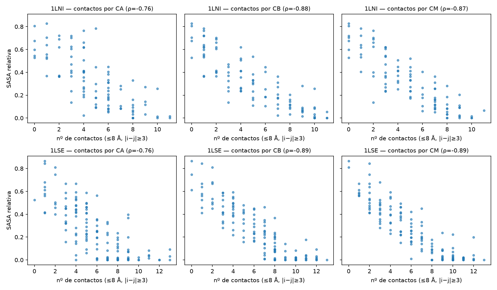
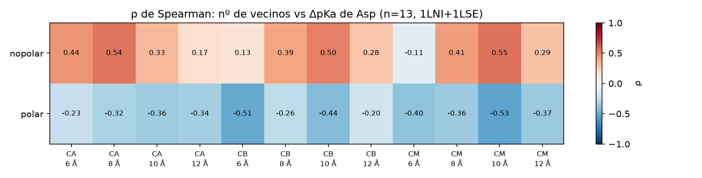
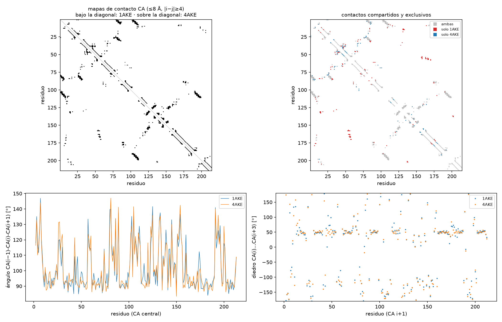
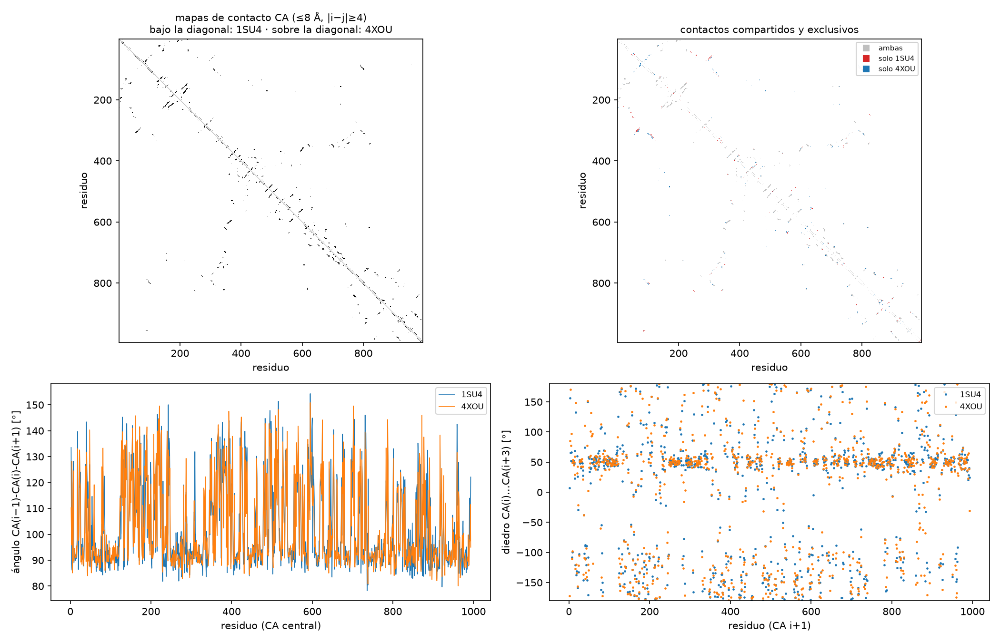
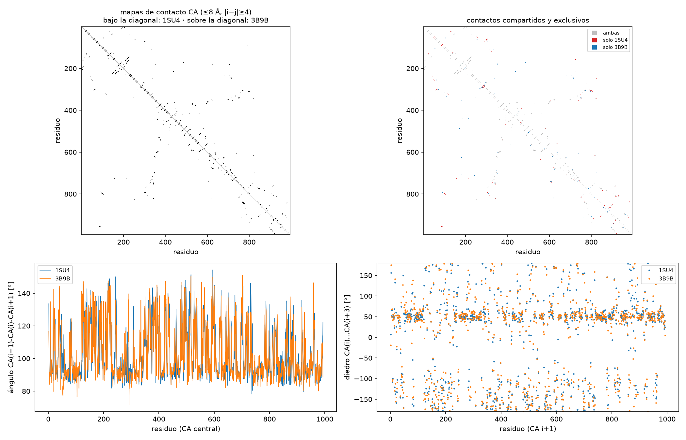
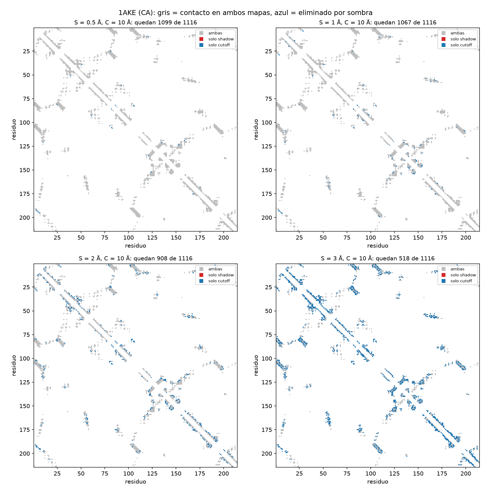

# TP 5: manejo y acceso de estructuras

Cada ejercicio se corre por separado desde la raíz del proyecto con el comando `venv/bin/python main.py <ejercicio>`, por ejemplo `venv/bin/python main.py 2b`; sin argumentos, lista los ejercicios disponibles. El ejercicio 3 es interactivo y está en el notebook `ex3_nglview.ipynb` (`venv/bin/jupyter lab ex3_nglview.ipynb`).

El código de cada ejercicio está en `exercises/`, y las funciones compartidas en `structures.py` (descarga y lectura de archivos), `contacts.py` (contactos y vecinos), `geometry.py` (ángulos, diedros y superposición), `pairs.py` (comparación de dos conformaciones, usada en 7 y 8) y `plots.py` (mapas de contacto). Las estructuras se bajan de RCSB la primera vez que se piden y quedan cacheadas en `data/`; los archivos que genera el TP (PDB nuevos, tablas, contactos, ángulos) quedan en `data/out/`. Las versiones de las librerías están en `requirements.txt`.

Las funciones de contactos tienen tests en `tests/` (`venv/bin/python -m pytest tests`), que verifican sobre geometrías armadas a mano propiedades que tienen que cumplirse siempre: que los mapas sean simétricos, que el mapa *shadow* con radio 0 sea idéntico al de *cutoff*, que agrandar el radio de sombra solo pueda sacar contactos y nunca agregarlos, y que un átomo ubicado sobre el segmento entre otros dos los ocluya mientras que uno corrido hacia el costado no.

---

## Datos

| PDB | Qué es | Organismo | Método, resolución | Usada en |
|---|---|---|---|---|
| 1A6M | oximioglobina | cachalote | rayos X, 1,0 Å | 1, 2, 4, 5 |
| 1HHO | oxihemoglobina | humano | rayos X, 2,1 Å | 2, 4 |
| 3RGK | mioglobina (mutante K45R) | humano | rayos X, 1,65 Å | 5 |
| 1LNI | ribonucleasa Sa | *S. aureofaciens* | rayos X, 1,0 Å | 6 |
| 1LSE | lisozima | gallina | rayos X, 1,7 Å | 6 |
| 1AKE / 4AKE | adenilato quinasa cerrada / abierta | *E. coli* | rayos X, 2,0 / 2,2 Å | 7, 9 |
| 1SU4 / 4XOU / 3B9B | Ca²⁺-ATPasa (SERCA1a) en tres estados | conejo | rayos X, 2,4 / 2,8 / 2,65 Å | 8 |

Elegimos 1A6M como mioglobina de referencia porque, además de ser la que sugiere la consigna, tiene O₂ unido (sirve también para el ejercicio 4) y una resolución de 1,0 Å, de las mejores disponibles. 1LNI y 1LSE vienen dadas por la tabla del ejercicio 6, y 1AKE/4AKE y las tres SERCA por los ejercicios 7 y 8.

En las estructuras con más de una cadena trabajamos con la cadena A salvo que se indique lo contrario.

---

## Conceptos básicos

Esta sección reúne los conceptos que usamos en todo el TP, para que el resto del informe se pueda leer sin conocimientos previos de biología.

**Proteína, aminoácido y residuo.** Una proteína es una cadena de piezas más chicas llamadas aminoácidos. Hay 20 tipos, que se nombran con un código de tres letras (HIS, ASP, GLY…) o de una letra (H, D, G…), así que la secuencia de una proteína se puede escribir como un string, por ejemplo `VLSEGEWQLV...`. La cadena no queda estirada: se pliega sobre sí misma en una forma tridimensional precisa, que es lo que describen los archivos que usamos. A cada eslabón de la cadena se lo llama **residuo**.

**El archivo PDB.** Una estructura experimental es, básicamente, una lista de átomos con sus coordenadas x, y, z (en ångström; 1 Å = 10⁻¹⁰ m, del orden del tamaño de un átomo). En el formato PDB cada átomo es una línea. Por ejemplo, el primer aminoácido de la mioglobina (una valina) ocupa siete líneas:

```
ATOM      1  N   VAL A   1      -4.004  15.224  13.636  1.00 32.64           N
ATOM      2  CA  VAL A   1      -3.526  15.758  14.900  1.00 18.42           C
ATOM      3  C   VAL A   1      -2.662  14.733  15.628  1.00 17.06           C
...
```

Las columnas que más usamos son el nombre del átomo (`N`, `CA`, `C`…), el aminoácido (`VAL`), la cadena (`A`), el número de residuo (`1`), las tres coordenadas y, al final, el elemento químico (`N`, `C`…). Las líneas de la proteína empiezan con `ATOM`; las de todo lo demás (agua, iones, otras moléculas) con `HETATM`. Antes de los átomos, el archivo tiene registros de encabezado con información sobre el experimento y las moléculas (`HETNAM`, `FORMUL`, `SEQRES`, `LINK`, `COMPND`…), varios de los cuales usamos como controles a lo largo del TP.

**La jerarquía SMCRA.** Biopython organiza el archivo como un árbol: una estructura tiene modelos, un modelo tiene cadenas, una cadena tiene residuos y un residuo tiene átomos. Algunas proteínas están formadas por varias cadenas; en el archivo cada una tiene una letra (A, B…).

**Los tres tipos de residuo.** Para Biopython es "residuo" todo lo que cuelga de una cadena, no solo los aminoácidos. El tipo se lee en el primer elemento del `id` del residuo (el campo *hetero*):

| tipo | ejemplo | campo hetero |
|---|---|---|
| aminoácido | HIS 93 | `' '` |
| agua | HOH | `'W'` |
| cualquier otra molécula | HEM, OXY, SO4, CA (ion calcio) | `'H_'` + nombre, por ejemplo `'H_HEM'` |

Todos los filtros del TP (`is_amino`, `is_water`, `is_ligand` en `structures.py`) se basan en este campo.

**El carbono alfa (CA).** Todos los aminoácidos, sin importar su tipo, tienen un átomo de carbono central llamado carbono alfa (`CA`), por el que se enganchan a la cadena. Quedándose con un CA por aminoácido se obtiene una versión simplificada de la proteína (un punto por residuo) que conserva su forma general; es la representación que usan los ejercicios 7 a 9.

**Resolución.** Indica qué tan nítido fue el experimento, en Å. Cuanto más chica, mejor: 1 Å permite ver detalles finos (como átomos que ocupan dos posiciones), mientras que por encima de ~3 Å la posición de cada átomo es bastante incierta. Varias diferencias que encontramos entre estructuras se explican por su resolución.

---

## 1

> **1)** Baje del Protein Data bank una estructura de su elección tanto en formato PDB como en formato CIF. Utilice biopython para cargar ambos archivos y explorar un poco qué propiedades del header y demás puede obtener.

La misma estructura se puede guardar en dos formatos de archivo: **PDB** (`.pdb`), el formato histórico, de columnas de ancho fijo, y **mmCIF** (`.cif`), el estándar oficial del Protein Data Bank desde 2014, que guarda la información como pares clave–valor y no tiene los límites de tamaño del formato viejo. La relación es parecida a la de una misma tabla guardada en `.csv` y en `.json`: cambia la forma de escribirla, no el contenido.

Cargamos 1A6M con `PDBParser` y con `MMCIFParser`. Como control de que los dos archivos describen lo mismo, contamos modelos, cadenas, residuos y átomos en cada objeto: dan exactamente igual (1 modelo, 1 cadena, 341 residuos y 1445 átomos en ambos casos).

Del header del PDB salen los datos básicos del experimento:

```
name                   oxy-myoglobin, atomic resolution
deposition_date        1998-02-26
structure_method       x-ray diffraction
resolution             1.0
author                 J.Vojtechovsky,K.Chu,J.Berendzen,R.M.Sweet,I.Schlichting
has_missing_residues   False
source                 physeter catodon (cachalote)
```

El header que arma `MMCIFParser` es más pobre que el del PDB: trae el nombre, el método y la resolución, pero por ejemplo la fecha de liberación queda vacía (`None`). En cambio, leyendo el mmCIF como diccionario con `MMCIF2Dict` se accede a 704 claves, con información que el header del PDB no expone directamente, como la descripción de cada molécula presente en el archivo:

```
_entity.pdbx_description   ['MYOGLOBIN', 'SULFATE ION', 'PROTOPORPHYRIN IX CONTAINING FE', 'OXYGEN MOLECULE', 'water']
_symmetry.space_group_name_H-M   ['P 1 21 1']
```

Es decir que el archivo no contiene solamente la proteína: también hay agua, iones sulfato, el grupo hemo (*protoporphyrin IX containing Fe*) y la molécula de O₂, lo que se retoma en el ejercicio 2.

El dato del header que más vamos a usar para interpretar resultados es la **resolución** (ver *Conceptos básicos*): 1,0 Å es una resolución excelente, y es una de las razones por las que elegimos esta estructura.

**Cómo obtuvimos las claves del header.** Las claves que imprimimos son las que lista la consigna. De esa lista dejamos fuera de la tabla `structure_reference` y `journal_reference`, que son textos bibliográficos largos, e imprimimos aparte `compound` y `source`, que son a su vez diccionarios. Además de las claves que lista la consigna, el diccionario `structure.header` de la versión de Biopython usada (1.88) incluye otras, que encontramos inspeccionando `structure.header.keys()`:

- `idcode`: el código PDB de la estructura.
- `keywords`: palabras clave asignadas por los autores (para 1A6M: *heme protein, oxygen storage, ligand binding geometry*…).
- `journal`: la referencia de la publicación original (Vojtechovsky et al., *Biophys. J.* 1999, para 1A6M).
- `biomoltrans`: las transformaciones (rotación + traslación) que reconstruyen la molécula biológica completa a partir de las cadenas depositadas. En 1A6M es solo la identidad, porque la mioglobina es una cadena única. En 1HHO hay una segunda transformación que genera las dos cadenas faltantes del tetrámero de hemoglobina a partir de las dos (α y β) presentes en el archivo.

---

## 2a

> **2a)** Identificar el residuo HEMO de la Mb y obtener su id y full_id (¿hay algún otro residuo que NO es de la proteína y NO es agua?)

La mioglobina almacena oxígeno en los músculos. No lo hace con sus aminoácidos sino con una molécula que lleva adentro, el **grupo hemo**: un anillo plano con un átomo de hierro en el centro, al que se une el O₂. Para Biopython el hemo es un residuo más de la cadena A, de tipo hetero.

```
HEM  id=('H_HEM', 154, ' ')  full_id=('1A6M', 0, 'A', ('H_HEM', 154, ' '))
```

El `id` es la tupla (campo hetero, número de residuo, código de inserción): `H_HEM` indica que es un heterorresiduo llamado HEM, en la posición 154. El `full_id` agrega el camino completo en la jerarquía SMCRA: estructura 1A6M, modelo 0, cadena A.

**Cómo sabemos que ese residuo es el hemo.** La forma directa de encontrarlo es buscar el residuo llamado `HEM`, que es el código que el Protein Data Bank asigna al hemo de las globinas en su diccionario de componentes químicos. Pero eso es confiar en que el código significa lo que suponemos. Además, no es universal: otras proteínas usan variantes del hemo con otros códigos (`HEC` en el citocromo c, `HEA` para el hemo a), y una búsqueda por nombre no las encontraría. Por eso no nos quedamos con el nombre y lo contrastamos con dos controles independientes:

1. **Por contenido.** Buscamos también el residuo que no es proteína ni agua y contiene un átomo de hierro, que es lo que define químicamente a un hemo. Las dos búsquedas señalan el mismo residuo.
2. **Por fórmula.** El registro `FORMUL` del archivo declara la fórmula del componente `HEM`: C34 H32 Fe N4 O4, y el registro `HETNAM` su nombre, *protoporphyrin IX containing Fe*. Sin hidrógenos, que los rayos X prácticamente no resuelven, la fórmula da 34 C + 1 Fe + 4 N + 4 O = 43 átomos, exactamente los átomos que tiene el residuo encontrado, elemento por elemento. Biopython no lee este registro, así que lo leemos directamente del texto del archivo.

Si alguno de estos controles fallara, el programa se detiene en lugar de seguir con un residuo equivocado.

Para encontrar los demás residuos que no son proteína ni agua filtramos por el campo hetero: los aminoácidos tienen `' '`, el agua `'W'` y el resto `'H_<nombre>'`. Además del hemo aparecen dos iones sulfato (SO4) y la molécula de oxígeno (OXY). El O₂ es parte de la función de la proteína; los sulfatos no. Moléculas así suelen provenir de la solución en la que se cristalizó la proteína, pero el archivo de 1A6M solo informa el pH de cristalización (registro `REMARK 280`) y no sus componentes, así que no podemos confirmarlo para este caso.

## 2b

> **2b)** Levante un PDB y obtenga: a) el número de cadenas, b) el número de residuos, c) número de átomos totales, d) número de átomos de proteína, e) número de HETatoms, f) número de átomos de agua.

Lo corrimos sobre la mioglobina (una cadena) y la hemoglobina (dos cadenas):

| | 1A6M | 1HHO |
|---|---|---|
| cadenas | 1 | 2 |
| residuos (todos) | 341 | 401 |
| residuos de proteína | 151 | 287 |
| átomos totales | 1445 | 2396 |
| átomos de proteína | 1204 | 2192 |
| HETATM (incluye agua) | 241 | 204 |
| HETATM (sin agua) | 55 | 95 |
| átomos de agua | 186 | 109 |

"Número de HETatoms" es ambiguo: en el formato PDB el agua también se escribe como `HETATM`, así que reportamos los dos números. Como control, en ambas estructuras los átomos totales son exactamente la suma de los de proteína y los HETATM.

"Residuos" también es ambiguo, porque Biopython cuenta como residuo a cada molécula de agua y a cada ligando: de los 341 residuos de 1A6M, solo 151 son aminoácidos.

**Control independiente contra el texto del archivo.** Los números anteriores dependen de cómo Biopython interpreta el archivo, así que los recontamos leyendo directamente las líneas `ATOM` y `HETATM`. En la hemoglobina el conteo de líneas coincide exactamente (2192 `ATOM`, 204 `HETATM`, 109 de agua). En la mioglobina no: el archivo tiene 1336 líneas `ATOM` y 248 `HETATM`, contra 1204 y 241 átomos según Biopython.

La diferencia está en las **posiciones alternativas** (*altlocs*). A 1,0 Å de resolución se llega a ver que algunos átomos ocupan dos posiciones distintas en el cristal, y el archivo los escribe una vez por posición (en 1A6M hay 278 líneas así; en 1HHO, a 2,1 Å, ninguna). Biopython los cuenta como un único átomo. Para confirmar que esa es toda la explicación, contamos sobre el texto cada átomo una sola vez —identificado por cadena, número de residuo y nombre de átomo, sin importar la posición alternativa— y obtuvimos exactamente 1204, 241 y 186, los mismos números que Biopython. El programa verifica esta coincidencia en las dos estructuras.

## 2c

> **2c)** Levante un PDB y determine la secuencia de aminoácidos de cada cadena.

Recorremos los residuos de proteína de cada cadena y convertimos el nombre de tres letras a una letra con `seq1`.

Esta secuencia es la de los aminoácidos **que tienen coordenadas**, y eso tiene dos maneras de no coincidir con la secuencia real de la proteína: que haya tramos que el experimento no logró resolver (y que entonces faltan en el archivo, sin ningún aviso), o que haya aminoácidos modificados químicamente, que el archivo marca como heterorresiduos y que nuestro filtro dejaría afuera. Para descartar las dos cosas hacemos dos controles:

1. que la numeración de residuos no tenga saltos;
2. que la secuencia obtenida sea idéntica a la de los registros `SEQRES` del archivo, que es la secuencia que los autores declaran para la molécula usada en el experimento, independientemente de qué partes se hayan visto. Biopython no usa estos registros para construir la estructura, así que los leemos del texto.

En las tres cadenas no hay saltos y la secuencia coincide exactamente con `SEQRES`.

```
>1A6M_A len=151
VLSEGEWQLVLHVWAKVEADVAGHGQDILIRLFKSHPETLEKFDRFKHLKTEAEMKASEDLKKHGVTVLTALGAILKKKGHHEAELKPLAQSHATKHKIPIKYLEFISEAIIHVLHSRHPGDFGADAQGAMNKALELFRKDIAAKYKELGY
>1HHO_A len=141
VLSPADKTNVKAAWGKVGAHAGEYGAEALERMFLSFPTTKTYFPHFDLSHGSAQVKGHGKKVADALTNAVAHVDDMPNALSALSDLHAHKLRVDPVNFKLLSHCLLVTLAAHLPAEFTPAVHASLDKFLASVSTVLTSKYR
>1HHO_B len=146
VHLTPEEKSAVTALWGKVNVDEVGGEALGRLLVVYPWTQRFFESFGDLSTPDAVMGNPKVKAHGKKVLGAFSDGLAHLDNLKGTFATLSELHCDKLHVDPENFRLLGNVLVCVLAHHFGKEFTPPVQAAYQKVVAGVANALAHKYH
```

Además de la mioglobina usamos la hemoglobina, que tiene dos cadenas, para que "cada cadena" tenga sentido: con una sola cadena el resultado no muestra que el código separa las secuencias por cadena.

En 1HHO, la cadena A es la globina α (141 residuos) y la B la β (146). La letra de cada cadena es solo una etiqueta que eligen los autores; qué es cada una lo dice el registro `COMPND` del archivo (`CHAIN: A` → *alpha chain*, `CHAIN: B` → *beta chain*), y coincide con los largos conocidos de las dos globinas.

## 2d

> **2d)** Levante un PDB y obtenga un nuevo PDB que contenga "solo" los CA.

El objetivo es pasar de la estructura completa (1204 átomos de proteína, más agua, hemo, O₂ y sulfatos) a un archivo con un punto por aminoácido: el carbono alfa de cada uno (ver *Conceptos básicos*). El archivo resultante empieza así, con las mismas líneas y coordenadas que tenían esos átomos en el original:

```
ATOM      1  CA  VAL A   1      -3.526  15.758  14.900  1.00 18.42           C
ATOM      2  CA  LEU A   2      -0.689  14.190  16.862  1.00 11.02           C
ATOM      3  CA  SER A   3      -1.487  12.495  20.143  1.00 11.06           C
```

Usamos `PDBIO` con un `Select` que acepta un átomo solo si cumple dos condiciones: que pertenezca a un **residuo de proteína** y que se llame `CA`.

La primera condición parece redundante pero no lo es: "CA" es tanto la abreviatura de carbono alfa como el símbolo químico del **calcio**, y los iones calcio también aparecen en los archivos PDB con el nombre `CA`. En la mioglobina no hay calcio, pero sí en la bomba de calcio del ejercicio 8. En 1SU4, por ejemplo:

```
ATOM      2  CA  MET A   1      86.599  22.039  54.090  1.00 78.40           C    ← carbono alfa
HETATM 7673 CA    CA A 995      64.194  12.588   7.315  1.00 41.55          CA    ← ion calcio
HETATM 7674 CA    CA A 996      59.861  15.511   4.476  1.00 44.28          CA    ← ion calcio
```

Los dos tipos de línea tienen un átomo llamado `CA`, pero el ion es un `HETATM`, su "residuo" es el propio ion (no un aminoácido) y su elemento es calcio (`CA`) y no carbono (`C`); el encabezado lo confirma (`HETNAM CA CALCIUM ION`). Biopython trata al ion como un residuo de tipo hetero (`H_CA`), así que la condición de que el residuo sea un aminoácido lo excluye. Filtrando solo por nombre de átomo, el calcio quedaría incluido como si fuera un carbono alfa. Aunque en la mioglobina el filtro no cambia el resultado, lo mantenemos porque la misma función (`ca_atoms` en `structures.py`) se usa en los ejercicios 7 a 9, donde sí hay calcio.

En lugar de confiar en el filtro, releemos el archivo escrito (`data/out/1A6M_CA.pdb`) y verificamos que tenga 151 átomos, uno por aminoácido, y que todos se llamen `CA`; el programa se detiene si no es así.

---

## 3

> **3)** Juegue un poco con el nglview, intente graficar uno (o algunos pocos residuos aislados), cambiar el tipo de representación etc.

nglview es un visualizador 3D de estructuras que funciona dentro de un notebook de Jupyter: recibe la estructura cargada con Biopython y la dibuja de forma interactiva (se puede rotar, hacer zoom, etc.). Por eso este ejercicio no está en `main.py` sino en el notebook `ex3_nglview.ipynb`.

Cada visualización se arma con **representaciones**: maneras de dibujar una parte de la estructura. Las que usamos son:

| representación | qué dibuja | para qué sirve |
|---|---|---|
| `cartoon` | la cadena como una cinta, sin átomos | ver la forma general y las hélices |
| `licorice` | los enlaces como bastones | ver una molécula chica con detalle |
| `ball+stick` | átomos como bolitas unidas por bastones | lo mismo, marcando cada átomo |
| `spacefill` | cada átomo como una esfera de su tamaño | ver un átomo puntual (el hierro) |
| `surface` | la superficie de la proteína | ver qué queda afuera y qué adentro |

Cada representación se aplica a una **selección**, escrita en el lenguaje de NGL: `protein`, un nombre de residuo (`HEM`), números de residuo (`93 or 64`), una cadena (`:A`), un rango (`30-59`) o un elemento (`_FE`).

Armamos cuatro visualizaciones:

1. **La representación por defecto** de la mioglobina, sin configurar nada.
2. **El sitio del oxígeno de la mioglobina**: la proteína en `cartoon` gris, el hemo y el O₂ como bastones, el hierro como esfera, y dos histidinas en naranja. La His93 es la que está unida al hierro por debajo del hemo (lo dice el registro `LINK` del archivo, ver ejercicio 4). La His64 está del otro lado, junto al O₂: medimos con Biopython que su átomo NE2 está a 2,97 Å del O₂, la distancia típica de un puente de hidrógeno.
3. **Residuos aislados**: solo los siete Asp de la lisozima que aparecen en la tabla del ejercicio 6, como `ball+stick`, sobre la superficie de la proteína en transparencia, para ver cuáles quedan en la superficie y cuáles adentro. En una primera versión del notebook habíamos escrito que los de pKa más bajo eran los más expuestos; lo sacamos porque el ejercicio 6 mostró lo contrario: la exposición sola no correlaciona con el pKa (ρ = 0,14).
4. **La adenilato quinasa cerrada** (1AKE), coloreada por dominio (NMP en azul, LID en rojo, el resto en gris) y con el inhibidor Ap5A en bastones, como anticipo del ejercicio 7. Los límites de los dominios (NMP 30–59, LID 122–159) no están en el archivo: los tomamos de la literatura sobre esta enzima.

Verificamos que el notebook corre completo sin errores (`jupyter nbconvert --execute`) y, abriéndolo en JupyterLab, que las cuatro visualizaciones se dibujan correctamente. La segunda verificación es necesaria: como los visores son interactivos y se dibujan en el navegador, que el código corra sin errores no garantiza que se vean.

**Problema de instalación.** Con la última versión de nglview (4.0.1) los visores no se dibujaban, y JupyterLab mostraba el error *"Module nglview-js-widgets, version 4.0 is not registered, however 3.1.5 is"*. nglview tiene dos partes: una en Python, que corre en el kernel, y una en JavaScript, que dibuja en el navegador, y las dos tienen que ser de la misma versión. Comparando los archivos instalados encontramos que el propio paquete 4.0.1 viene desparejo: su parte de Python pide la versión 4.0 de la parte del navegador, pero instala la 3.1.5. Es un error de empaquetado de esa versión, no de nuestra instalación. Lo resolvimos usando nglview 3.1.4, cuyas dos partes coinciden (verificado en los archivos instalados). Esa versión importa `pkg_resources`, un módulo de `setuptools` que los entornos nuevos de Python 3.12 no traen y que las versiones más recientes de `setuptools` eliminaron, así que también fijamos `setuptools<81`. Las dos versiones quedan en `requirements.txt`. Un detalle del diagnóstico: que el notebook "corra sin errores" desde la terminal no alcanzaba para detectar este problema, porque la parte rota era la del navegador.

---

## 4

> **4)** Busque en el PDB la oximioglobina (y la oxihemoglobina), cárguela en Biopython y calcule: distancia Fe-O, ángulo Fe-O-O, diedro N-Fe-O-O.

Medimos sobre tres sitios: la mioglobina (1A6M) y las dos cadenas de la hemoglobina (1HHO, cadena A = α y cadena B = β). En cada una buscamos el hierro del hemo (residuo `HEM`, átomo `FE`) y los dos oxígenos (residuo `OXY`).

Tomamos como oxígeno unido al hierro al más cercano, en lugar de confiar en los nombres O1 y O2 del archivo, que no garantizan cuál es cuál. En los tres sitios resultó ser O1, y la distancia Fe–O coincide con la que los autores anotaron en los registros `LINK` del archivo (1,81 Å en 1A6M; 1,66 y 1,86 Å en 1HHO), lo que sirve de control independiente.

El hierro del hemo está unido a seis átomos: los cuatro nitrógenos del anillo del hemo (NA, NB, NC, ND), en el plano; una histidina de la proteína por debajo (la *histidina proximal*: His93 en la mioglobina, His87 en la α y His92 en la β); y el O₂ por arriba.

"N" en el diedro N-Fe-O-O es ambiguo. Descartamos el nitrógeno de la histidina proximal: el ángulo NE2–Fe–O da entre 175° y 177°, es decir que esos tres átomos están casi alineados y no definen un plano, y sin plano el diedro no está definido. Reportamos en cambio el diedro con cada uno de los cuatro nitrógenos del hemo, que describe hacia dónde apunta el O₂ sobre el plano del anillo. Como esos nitrógenos están a 90° entre sí, los cuatro diedros deberían diferir en ~90°, y así ocurre (por ejemplo −159°, 111°, 22°, −69° en la mioglobina).

| | Mb (1A6M) | Hb α (1HHO A) | Hb β (1HHO B) |
|---|---|---|---|
| d(Fe–O) | 1,81 Å | 1,66 Å | 1,86 Å |
| d(O–O) | 1,24 Å | 1,22 Å | 1,24 Å |
| ∠ Fe–O–O | 122,5° | 152,6° | 158,7° |
| ∠ NE2–Fe–O | 176,4° | 176,7° | 174,8° |
| diedro NA–Fe–O–O | −158,9° | −164,4° | 129,5° |
| diedro NB–Fe–O–O | 111,1° | 112,1° | 40,2° |
| diedro NC–Fe–O–O | 21,5° | 19,3° | −48,8° |
| diedro ND–Fe–O–O | −68,8° | −67,8° | −132,8° |

En la mioglobina el O₂ se une al hierro **doblado**, a ~120°, el valor esperado para O₂ unido al hierro de un hemo. En la hemoglobina los ángulos dan bastante más abiertos (153° y 159°). No lo interpretamos como una diferencia real entre las dos proteínas sino como una consecuencia de la calidad de los datos: 1HHO es una estructura de 1983 a 2,1 Å, y a esa resolución una molécula de dos átomos como el O₂ se ubica con mucha incerteza, mientras que 1A6M está a 1,0 Å. Un ángulo medido sobre una estructura no puede ser más preciso que la estructura misma.

---

## 5

> **5)** Elija dos proteínas homólogas, obtenga las estructuras y superpóngalas.

Superpusimos la mioglobina humana (3RGK, móvil) sobre la de cachalote (1A6M, referencia).

Para superponer hacen falta pares de átomos equivalentes, y en este caso no se pueden emparejar por número de residuo: las cadenas tienen distinto largo (151 y 149) y numeración independiente. Por eso primero alineamos las dos secuencias (`PairwiseAligner`, global, BLOSUM62, gaps −10/−0,5; el TP no pide implementar el alineamiento, así que lo usamos como herramienta) y tomamos como equivalentes los CA de los residuos alineados entre sí. Resultaron 149 pares, con 85,9% de identidad de secuencia.

```
RMSD antes de superponer:         20,08 Å
RMSD reportado por Superimposer:   0,614 Å
RMSD recalculado tras aplicar:     0,614 Å
```

El RMSD sin superponer no tiene significado estructural: solo refleja que cada estructura está en su propio sistema de coordenadas. Después de aplicar la rotación y traslación que calcula `Superimposer`, las dos mioglobinas difieren en 0,61 Å en promedio, es decir que son prácticamente la misma estructura, como era esperable para dos proteínas con 86% de identidad y la misma función. Como control, recalculamos el RMSD directamente desde las coordenadas ya movidas, sin usar `Superimposer`, y da el mismo valor.

La estructura móvil superpuesta queda en `data/out/3RGK_on_1A6M.pdb`, y se puede abrir junto a 1A6M en cualquier visualizador.

---

## 6

Para este ejercicio usamos las dos proteínas de la tabla del punto v: la ribonucleasa Sa (1LNI, cadena A) y la lisozima (1LSE).

Representamos cada residuo con un punto, de tres maneras distintas que se comparan a lo largo del ejercicio:

- **CA**: el carbono alfa, que está en el esqueleto de la cadena.
- **CB**: el carbono beta, el primer átomo de la cadena lateral.
- **CM**: el centro de masa de la cadena lateral, sin hidrógenos.

La glicina no tiene cadena lateral (ni CB), así que en los tres casos se la representa con su CA.

## 6i

> **6i)** Medir la superficie accesible expuesta de los residuos utilizando la herramienta de Biopython Bio.PDB.SASA.

Usamos `ShrakeRupley` a nivel residuo. La SASA se calcula sobre la cadena sola, después de sacarle aguas, ligandos e hidrógenos:

- las aguas del cristal y los ligandos taparían superficie que en solución está expuesta;
- 1LSE trae 462 hidrógenos y 1LNI ninguno; sin sacarlos, las SASA de las dos proteínas no serían comparables.

Además de la SASA absoluta (Ų) calculamos la **SASA relativa** (RSA), dividiendo por la máxima teórica de cada tipo de aminoácido (Tien et al. 2013). Hace falta porque un aminoácido grande como la arginina expone más superficie que uno chico como la alanina aunque estén igual de enterrados.

La SASA total es de 5679 Ų para 1LNI (96 residuos) y 6637 Ų para 1LSE (129 residuos). Los más expuestos son mayoritariamente argininas, y en las dos proteínas hay residuos con SASA 0, completamente enterrados, en su mayoría hidrofóbicos (Ala, Val, Ile, Leu, Trp). La tabla completa por residuo queda en `data/out/ex6_residuos.csv`.

## 6ii

> **6ii)** Medir distancias entre CA, entre CB y entre los centros de masa de las cadenas laterales. En base a un valor de corte (puede ser 8 Å) definir los contactos.

Definimos que dos residuos están en contacto si sus puntos representativos están a 8 Å o menos y están separados por al menos 3 posiciones en la secuencia. Esta segunda condición la agregamos porque los residuos vecinos en la cadena están siempre cerca entre sí por estar unidos, y contarlos como contactos no dice nada sobre el plegamiento.

| | CA (media / máx.) | CB | CM |
|---|---|---|---|
| 1LNI | 4,9 / 11 | 5,0 / 11 | 4,9 / 11 |
| 1LSE | 5,8 / 13 | 6,3 / 13 | 6,2 / 13 |

## 6iii

> **6iii)** Evaluar la correlación entre el número de contactos medidos de diferentes formas y la SASA.

Usamos la correlación de Spearman además de la de Pearson, porque el número de contactos es un entero chico y no hay motivo para esperar una relación lineal con la SASA.

| | contactos por | vs SASA | vs RSA |
|---|---|---|---|
| 1LNI | CA | −0,70 | −0,76 |
| | CB | −0,81 | −0,88 |
| | CM | −0,81 | −0,87 |
| 1LSE | CA | −0,67 | −0,76 |
| | CB | −0,81 | −0,89 |
| | CM | −0,84 | −0,89 |

(ρ de Spearman; Pearson da valores parecidos.)



La correlación es fuertemente negativa en todos los casos: cuantos más contactos tiene un residuo, más enterrado está, que es lo esperable. Dos cosas se repiten en las dos proteínas:

- la correlación es mejor con la SASA relativa que con la absoluta, porque la absoluta mezcla el grado de exposición con el tamaño del aminoácido;
- contar contactos por CB o por centro de masa funciona mejor que por CA. El CA está en el esqueleto, mientras que la SASA depende sobre todo de la cadena lateral, que es lo que sobresale hacia afuera o hacia adentro de la proteína.

## 6iv

> **6iv)** Parado en el CB de las cadenas laterales, defina el radio de una esfera, y mida el número de vecinos polares (S,T,K,R,D,E,Q,N) y no polares (I,L,V,W,Y,F,M) midiendo distancias entre CA, entre CB, y desde el centro de masa de la cadena lateral. Definir al menos 3 radios de esfera.

Usamos cuatro radios: 6, 8, 10 y 12 Å. Para cada residuo contamos cuántos *otros* residuos polares y no polares tienen su punto representativo dentro de la esfera, con el mismo tipo de punto en el centro y en los vecinos (CA con CA, CB con CB, CM con CM). Los aminoácidos que no están en ninguna de las dos listas de la consigna (G, A, C, P, H) no se cuentan en ninguna clase.

Promedio de vecinos por residuo:

| | radio | 1LNI no polares | 1LNI polares | 1LSE no polares | 1LSE polares |
|---|---|---|---|---|---|
| CA | 6 Å | 1,6 | 2,1 | 1,6 | 2,5 |
| | 8 Å | 3,1 | 3,8 | 2,9 | 4,3 |
| | 10 Å | 5,5 | 6,6 | 5,4 | 7,5 |
| | 12 Å | 8,6 | 10,3 | 8,6 | 11,7 |
| CB | 6 Å | 1,4 | 1,7 | 1,5 | 2,0 |
| | 8 Å | 3,2 | 3,6 | 3,1 | 4,2 |
| | 10 Å | 5,4 | 6,2 | 5,7 | 7,1 |
| | 12 Å | 8,6 | 9,9 | 8,9 | 11,3 |
| CM | 6 Å | 1,2 | 1,2 | 1,3 | 1,5 |
| | 8 Å | 2,7 | 3,0 | 2,8 | 3,3 |
| | 10 Å | 5,2 | 5,8 | 5,3 | 6,3 |
| | 12 Å | 8,3 | 9,1 | 8,6 | 10,3 |

El número de vecinos crece aproximadamente con el volumen de la esfera (r³), como es de esperar en un objeto compacto. Con radio de 6 Å hay en promedio uno o dos vecinos de cada clase, así que el conteo es muy ruidoso; a 12 Å la esfera abarca una fracción grande de proteínas de este tamaño y deja de describir el entorno local.

## 6v

> **6v)** Evalúe la correlación entre el número de vecinos polares y no polares, y el pKa de los residuos de los PDB de la siguiente tabla.

Los trece residuos de la tabla son aspárticos (lo verificamos en el código). El pKa de un ácido aspártico aislado en agua es ~4; en una proteína se corre según su entorno. Para cada uno calculamos el corrimiento ΔpKa = pKa experimental − 4 y lo correlacionamos (Spearman) con el número de vecinos de cada clase, para los tres tipos de punto y los cuatro radios.

| PDB | Asp | pKa exp. | ΔpKa | RSA | polares (CB, 8 Å) | no polares (CB, 8 Å) |
|---|---|---|---|---|---|---|
| 1LNI | 17 | 3,72 | −0,28 | 0,45 | 4 | 4 |
| 1LNI | 25 | 4,87 | +0,87 | 0,62 | 1 | 1 |
| 1LNI | 33 | 2,39 | −1,61 | 0,08 | 4 | 5 |
| 1LNI | 79 | 7,37 | +3,37 | 0,08 | 4 | 8 |
| 1LNI | 84 | 3,01 | −0,99 | 0,33 | 3 | 1 |
| 1LNI | 93 | 3,09 | −0,91 | 0,30 | 3 | 4 |
| 1LSE | 18 | 2,66 | −1,34 | 0,35 | 3 | 5 |
| 1LSE | 48 | 1,60 | −2,40 | 0,53 | 4 | 0 |
| 1LSE | 52 | 3,68 | −0,32 | 0,14 | 10 | 2 |
| 1LSE | 66 | 0,90 | −3,10 | 0,20 | 7 | 1 |
| 1LSE | 87 | 2,07 | −1,93 | 0,41 | 3 | 1 |
| 1LSE | 101 | 4,09 | +0,09 | 0,54 | 3 | 2 |
| 1LSE | 119 | 3,20 | −0,80 | 0,46 | 2 | 1 |



El signo de la correlación es consistente en casi todas las combinaciones: **más vecinos no polares se asocian con un pKa más alto, y más vecinos polares con un pKa más bajo**. Las correlaciones más fuertes son con centro de masa y radio de 10 Å (ρ = 0,55 para no polares, −0,53 para polares) y con CA a 8 Å (ρ = 0,54 para no polares).

Tiene una interpretación química: el aspártico cede un protón y queda con carga negativa. Rodeado de residuos no polares, esa carga no está estabilizada, así que le cuesta más ceder el protón y el pKa sube. El caso extremo es el Asp79 de 1LNI, enterrado (RSA 0,08) y con 8 vecinos no polares, cuyo pKa de 7,37 es tres unidades más alto que el de referencia. Rodeado de residuos polares (que pueden formar puentes de hidrógeno o tener carga positiva), la carga negativa se estabiliza y el pKa baja.

Sin embargo, **ninguna de estas correlaciones es estadísticamente significativa**: el menor p-valor es 0,05, y lo obtuvimos probando 24 combinaciones (3 tipos de punto × 4 radios × 2 clases) sobre solo 13 residuos. Con tantas combinaciones, encontrar alguna con p ≈ 0,05 es esperable aunque no haya ningún efecto real. Lo que sí sostenemos es que el signo es consistente con la explicación química y se repite en casi todas las combinaciones. Como referencia, la SASA relativa sola no correlaciona con el ΔpKa (ρ = 0,14, p = 0,65): no alcanza con saber si el residuo está enterrado, importa con qué está rodeado.

---

## 7

> **7)** Usando los módulos que armó previamente, lea el trabajo (Whitford et al. 2007) y repita el diseño experimental. A) baje las estructuras mencionadas en formato PDB. Considerando solo los carbonos alfa: B) calcule los contactos para ambas estructuras usando el método de 'cutoff'. C) calcule los contactos que están SOLAMENTE en la estructura cerrada (1AKE), usando la definición del trabajo. Calcule también los contactos exclusivos para cada estructura. Construya el mapa de contactos para cada estructura. D) mida los ángulos y los diedros considerando solamente los carbonos alfa.

La adenilato quinasa tiene dos conformaciones: una **abierta** (4AKE) y una **cerrada** (1AKE), en la que dos de sus dominios, LID y NMP, se cierran sobre el sitio activo; en 1AKE ese sitio está ocupado por el inhibidor Ap5A. Usamos la cadena A de cada estructura; ambas tienen los 214 residuos completos y la misma numeración, así que los CA se emparejan por número de residuo.

**Contactos por cutoff.** Dos CA están en contacto si están a 8 Å o menos y separados por al menos 4 posiciones en la secuencia. Subimos la separación mínima respecto del ejercicio 6 porque en una hélice los CA de i e i+3 están siempre a ~5 Å, y en un modelo de solo CA ese contacto es parte de la geometría local de la hélice, no del plegamiento entre regiones.

| | contactos |
|---|---|
| 1AKE (cerrada) | 453 |
| 4AKE (abierta) | 427 |
| compartidos | 379 |
| solo en 1AKE | 74 |
| solo en 4AKE | 48 |

**Contactos exclusivos.** Definimos como exclusivo de una estructura a un contacto que está en su mapa y no en el de la otra. El código permite además exigir que la distancia en la otra estructura aumente un mínimo (`EXCLUSIVE_MIN_DELTA` en `pairs.py`), para descartar pares que solo cruzan apenas el umbral de 8 Å; con el valor usado (0 Å) es la diferencia de conjuntos pura.

> **[pendiente: confirmar contra la definición de contactos exclusivos del trabajo de Whitford et al. y ajustar `EXCLUSIVE_MIN_DELTA` si corresponde]**



Arriba a la izquierda están los dos mapas superpuestos (1AKE bajo la diagonal, 4AKE sobre ella). Arriba a la derecha, los contactos compartidos en gris, los exclusivos de la forma cerrada en rojo y los de la abierta en azul. Los exclusivos de la cerrada que no están cerca de la diagonal forman grupos compactos entre regiones alejadas en la secuencia, el más claro entre los residuos ~50–57 (dominio NMP) y ~157–170: son regiones que solo se tocan cuando la enzima se cierra. Los exclusivos de la abierta, en cambio, están en su mayoría cerca de la diagonal o mezclados con contactos compartidos, es decir que son reacomodamientos locales.

**Ángulos y diedros.** Con solo CA, cada ángulo se forma con tres CA consecutivos y cada diedro con cuatro. Los guardamos en variables (diccionarios residuo → ángulo) y en `data/out/ex7_1AKE_4AKE.json`, junto con los contactos y los parámetros que los generaron, para usarlos en el TP de dinámica molecular. Si dos CA consecutivos estuvieran a más de 4,2 Å (indicio de residuos faltantes), los ángulos que cruzan ese hueco se descartan; en estas estructuras no hay ninguno.

Abajo en la figura se ve que los ángulos y diedros son casi idénticos en las dos conformaciones: el cambio entre abierta y cerrada es un movimiento de dominios como bloques rígidos, no un cambio de la estructura local. Las hélices se reconocen como tramos con ángulo ~90° y diedro ~50°, los valores característicos de una hélice α en representación de CA. Los diedros que más cambian (residuos 43–49 y 59, entre 40° y 58°) están todos en el dominio NMP (residuos 30–59), uno de los dos que se mueven al cerrarse la enzima.

---

## 8

> **8)** Repita los cálculos para los PDB 1SU4, 4XOU y 3B9B. Haga lo mismo que en el punto 7 para cada par de estructuras.

Las tres son la bomba de calcio SERCA1a de conejo en distintos estados de su ciclo: 1SU4 con dos iones calcio unidos, 4XOU con calcio y un análogo de ATP, y 3B9B en el estado E2 con un análogo del fosfato (BeF₃⁻). Tienen 994 residuos con la misma numeración, así que el análisis es el mismo que en el 7, para los tres pares.

| par | contactos A | contactos B | compartidos | solo A | solo B |
|---|---|---|---|---|---|
| 1SU4 – 4XOU | 2397 | 2490 | 2093 | 304 | 397 |
| 1SU4 – 3B9B | 2397 | 2408 | 2015 | 382 | 393 |
| 4XOU – 3B9B | 2490 | 2408 | 2065 | 425 | 343 |





En los tres pares, entre el 13 y el 17% de los contactos de cada estructura son exclusivos. Hay que leer estas cifras con cuidado: con un corte duro de 8 Å, un par a 7,9 Å en una estructura y 8,1 Å en la otra cuenta como exclusivo aunque prácticamente no se haya movido, y con tres estructuras de resolución moderada (2,4–2,8 Å) estos casos son frecuentes. Es justamente el motivo por el que dejamos parametrizable la diferencia mínima de distancia para considerar un contacto exclusivo.

Los diedros que más cambian entre pares lo hacen en ~160–180°. Un cambio de ese tamaño en un diedro de CA es un giro local de la cadena, típico de regiones flexibles o mal definidas a esta resolución, y no alcanza por sí solo para describir el movimiento de un dominio. Los resultados de cada par quedan en `data/out/ex8_<A>_<B>.json`.

---

## 9

> **9)** Implemente el cálculo del mapa de contactos usando el algoritmo del trabajo (Noel et al. 2012). Considere solamente los carbonos alfa. Grafique el mapa de contactos para diferentes valores de S. Compare con el mapa de contactos definido por 'cutoff'.

La idea del mapa *shadow* es que dos átomos cercanos no deberían contarse en contacto si hay otro átomo justo entre ellos. Partimos de los contactos por cutoff y, para cada par i–j, buscamos si algún otro átomo k lo ocluye:

1. proyectamos k sobre la recta que une i con j: t = ((k − i) · v) / (v · v), con v = j − i;
2. si 0 < t < 1, el pie de la perpendicular p = i + t·v cae entre i y j;
3. si además la distancia |k − p| es menor que el radio de sombra S, k ocluye a i–j y ese contacto se elimina.

Esto implementa la versión de la consigna, que simplifica el método del trabajo: en Noel et al. la sombra es un cono que proyecta k visto desde i, mientras que acá es un cilindro de radio S alrededor del segmento i–j. Corregimos además un detalle de la fórmula de la consigna: lo que se compara con S es la distancia |k − p|, no el punto t.

Consideramos como posibles oclusores a todos los átomos, no solo a los que están en contacto con i. Si k se proyecta dentro del segmento y está a menos de S de él, necesariamente está cerca de i, así que no se pierde nada, y de esta forma el resultado no depende de si se mira el par como i–j o como j–i.

Corrimos sobre los CA de 1AKE, con separación mínima de 4 en secuencia:

| cutoff | contactos (cutoff) | S = 0,5 Å | S = 1 Å | S = 2 Å | S = 3 Å |
|---|---|---|---|---|---|
| 8 Å | 453 | 453 | 453 | 448 | 321 |
| 10 Å | 1116 | 1099 | 1067 | 908 | 518 |
| 12 Å | 2283 | 2226 | 2104 | 1502 | 744 |



Con cutoff de 8 Å la sombra prácticamente no cambia nada hasta S = 2 Å: dos CA a menos de 8 Å casi nunca tienen un tercero en medio. El efecto aparece al agrandar el cutoff: a 12 Å, con S = 2 Å, se elimina un tercio de los contactos. Ahí está la utilidad del método: permite usar un cutoff más generoso sin contar como contacto a residuos que están "detrás" de otros. Por eso el gráfico está hecho con cutoff de 10 Å, donde la diferencia se aprecia.

En el gráfico, gris son los contactos que están en ambos mapas y azul los que el shadow eliminó. No hay ningún contacto que esté en el shadow y no en el de cutoff (no hay puntos rojos), como tiene que ser: la sombra solo puede sacar contactos. Esta propiedad, junto con que S = 0 reproduce exactamente el mapa de cutoff y que agrandar S nunca agrega contactos, está verificada en los tests.
