# TP 5: manejo y acceso de estructuras

Cada ejercicio se corre por separado desde la raíz del proyecto con el comando `venv/bin/python main.py <ejercicio>`, por ejemplo `venv/bin/python main.py 2b`; sin argumentos, lista los ejercicios disponibles. Las visualizaciones 3D, que son interactivas y solo se ven en Jupyter, están en notebooks aparte, uno por ejercicio. Se abren con `venv/bin/jupyter lab <notebook>`.

El código de cada ejercicio está en su carpeta dentro de `exercises/` (por ejemplo `exercises/ex6/ex6.py`), junto con los gráficos que genera, y las funciones compartidas en `structures.py` (descarga y lectura de archivos), `contacts.py` (contactos y vecinos), `geometry.py` (ángulos, diedros y superposición), `pairs.py` (comparación de dos conformaciones, usada en 7 y 8) y `plots.py` (mapas de contacto). Las estructuras se bajan de RCSB la primera vez que se piden y quedan cacheadas en `data/`; los archivos que genera el TP (PDB nuevos, tablas, contactos, ángulos) quedan en `data/out/`. Las versiones de las librerías están en `requirements.txt`.

Las funciones de contactos y la lectura de estructuras tienen tests en `tests/` (`venv/bin/python -m pytest tests`), que verifican sobre geometrías armadas a mano propiedades que tienen que cumplirse siempre: que los mapas sean simétricos, que el mapa *shadow* con radio 0 sea idéntico al de *cutoff*, que agrandar el radio de sombra solo pueda sacar contactos y nunca agregarlos, y que un átomo ubicado sobre el segmento entre otros dos los ocluya mientras que uno corrido hacia el costado no.

---

## Datos

| PDB | Qué es | Organismo | Método, resolución | Usada en |
|---|---|---|---|---|
| 1A6M | oximioglobina | cachalote | rayos X, 1,0 Å | 1, 2, 4, 5 |
| 1HHO | oxihemoglobina | humano | rayos X, 2,1 Å | 2, 4 |
| 3RGK | mioglobina (mutante K45R) | humano | rayos X, 1,65 Å | 5 |
| 1LNI | ribonucleasa Sa | *S. aureofaciens* | rayos X, 1,0 Å | 6 |
| 1LSE | lisozima | gallina | rayos X, 1,7 Å | 6 |
| 1AKE / 4AKE | adenilato quinasa cerrada / abierta | *E. coli* | rayos X, 2,0 / 2,2 Å | 7, 9 |
| 1SU4 / 4XOU / 3B9B | Ca²⁺-ATPasa (SERCA1a) en tres estados | conejo | rayos X, 2,4 / 2,8 / 2,65 Å | 8 |

Elegimos 1A6M como mioglobina de referencia en primer lugar porque es la que sugiere la consigna, y en segundo, por su resolución de 1,0 Å, de las mejores disponibles. 1LNI y 1LSE vienen dadas por la tabla del ejercicio 6, y 1AKE/4AKE y las tres SERCA por los ejercicios 7 y 8.

En las estructuras con más de una cadena trabajamos con la cadena A salvo que se indique lo contrario.

---

## 1

> **1)** Baje del Protein Data bank una estructura de su elección tanto en formato PDB como en formato CIF. Utilice biopython para cargar ambos archivos y explorar un poco qué propiedades del header y demás puede obtener.

La misma estructura se puede guardar en dos formatos de archivo: **PDB** (`.pdb`), el formato histórico, de columnas de ancho fijo, y **mmCIF** (`.cif`), el estándar oficial del Protein Data Bank desde 2014, que guarda la información como pares clave–valor y no tiene los límites de tamaño del formato viejo.

Cargamos 1A6M con `PDBParser` y con `MMCIFParser`. Como control de que los dos archivos describen lo mismo, contamos modelos, cadenas, residuos y átomos en cada objeto: dan exactamente igual (1 modelo, 1 cadena, 341 residuos y 1445 átomos en ambos casos).

Del header del PDB salen los datos básicos del experimento:

```
name                   oxy-myoglobin, atomic resolution
deposition_date        1998-02-26
structure_method       x-ray diffraction
resolution             1.0
author                 J.Vojtechovsky,K.Chu,J.Berendzen,R.M.Sweet,I.Schlichting
has_missing_residues   False
source                 physeter catodon (cachalote)
```

El header que arma `MMCIFParser` es más pobre que el del PDB: trae el nombre, el método y la resolución, pero por ejemplo la fecha de liberación queda vacía (`None`). En cambio, leyendo el mmCIF como diccionario con `MMCIF2Dict` se accede a 704 claves, con información que el header del PDB no expone directamente, como la descripción de cada molécula presente en el archivo:

```
_entity.pdbx_description   ['MYOGLOBIN', 'SULFATE ION', 'PROTOPORPHYRIN IX CONTAINING FE', 'OXYGEN MOLECULE', 'water']
_symmetry.space_group_name_H-M   ['P 1 21 1']
```

Podemos ver que el archivo no contiene solamente la proteína: también hay agua, iones sulfato, el grupo hemo (*protoporphyrin IX containing Fe*) y la molécula de O₂.

El dato del header que más vamos a usar para interpretar resultados es la **resolución**.

**Cómo obtuvimos las claves del header.** Las claves que imprimimos son las que lista la consigna. De esa lista dejamos fuera de la tabla `structure_reference` y `journal_reference`, que son textos bibliográficos largos, e imprimimos aparte `compound` y `source`, que son a su vez diccionarios. Además de las claves que lista la consigna, el diccionario `structure.header` de la versión de Biopython usada (1.88) incluye otras, que encontramos inspeccionando `structure.header.keys()`:

- `idcode`: el código PDB de la estructura.
- `keywords`: palabras clave asignadas por los autores.
- `journal`: la referencia de la publicación original.
- `biomoltrans`: las transformaciones (rotación + traslación) que reconstruyen la molécula biológica completa a partir de las cadenas depositadas.

---

## 2a

> **2a)** Identificar el residuo HEMO de la Mb y obtener su id y full_id (¿hay algún otro residuo que NO es de la proteína y NO es agua?)

La mioglobina almacena oxígeno en los músculos. No lo hace con sus aminoácidos sino con una molécula que lleva adentro, el **grupo hemo** que mencionamos arriba.

```
HEM  id=('H_HEM', 154, ' ')  full_id=('1A6M', 0, 'A', ('H_HEM', 154, ' '))
```

El `id` es la tupla (campo hetero, número de residuo, código de inserción): `H_HEM` indica que es un heterorresiduo llamado HEM, en la posición 154. El `full_id` agrega el camino completo en la jerarquía SMCRA: estructura 1A6M, modelo 0, cadena A.

**Cómo sabemos que ese residuo es el hemo.** La forma directa de encontrarlo es buscar el residuo llamado `HEM`, que es el código que el Protein Data Bank asigna al hemo de las globinas en su diccionario de componentes químicos. Para evitar confiar ciegamente en la nomenclatura, decidimos verificarlo contrastándolo con dos controles independientes:

1. **Por contenido.** Buscamos también el residuo que no es proteína ni agua y contiene un átomo de hierro, que es lo que define químicamente a un hemo. Las dos búsquedas señalan el mismo residuo.
2. **Por fórmula.** El registro `FORMUL` del archivo declara la fórmula del componente `HEM`: C34 H32 Fe N4 O4, y el registro `HETNAM` su nombre, *protoporphyrin IX containing Fe*. Sin hidrógenos, que los rayos X prácticamente no resuelven, la fórmula da 34 C + 1 Fe + 4 N + 4 O = 43 átomos, exactamente los átomos que tiene el residuo encontrado, elemento por elemento (biopython no lee este registro, así que lo leemos directamente del texto del archivo).

Para encontrar los demás residuos que no son proteína ni agua filtramos por el campo hetero: los aminoácidos tienen `' '`, el agua `'W'` y el resto `'H_<nombre>'`. Además del hemo aparecen dos iones sulfato (SO4) y la molécula de oxígeno (OXY). El O₂ es parte de la función de la proteína; los sulfatos no. Moléculas así suelen provenir de la solución en la que se cristalizó la proteína, pero el archivo de 1A6M solo informa el pH de cristalización (registro `REMARK 280`) y no sus componentes, así que no podemos confirmarlo para este caso.

## 2b

> **2b)** Levante un PDB y obtenga: a) el número de cadenas, b) el número de residuos, c) número de átomos totales, d) número de átomos de proteína, e) número de HETatoms, f) número de átomos de agua.

Lo corrimos sobre la mioglobina (una cadena) y la hemoglobina (dos cadenas):

| | 1A6M | 1HHO |
|---|---|---|
| cadenas | 1 | 2 |
| residuos (todos) | 341 | 401 |
| residuos de proteína | 151 | 287 |
| átomos totales | 1445 | 2396 |
| átomos de proteína | 1204 | 2192 |
| HETATM (incluye agua) | 241 | 204 |
| HETATM (sin agua) | 55 | 95 |
| átomos de agua | 186 | 109 |

"Número de HETatoms" es ambiguo: en el formato PDB el agua también se escribe como `HETATM`, así que reportamos los dos números. Como control, en ambas estructuras los átomos totales son exactamente la suma de los de proteína y los HETATM.

"Residuos" también es ambiguo, porque Biopython cuenta como residuo a cada molécula de agua y a cada ligando: de los 341 residuos de 1A6M, solo 151 son aminoácidos.

**Control independiente contra el texto del archivo.** Los números anteriores dependen de cómo Biopython interpreta el archivo, así que los recontamos leyendo directamente las líneas `ATOM` y `HETATM`. En la hemoglobina el conteo de líneas coincide exactamente (2192 `ATOM`, 204 `HETATM`, 109 de agua). En la mioglobina no: el archivo tiene 1336 líneas `ATOM` y 248 `HETATM`, contra 1204 y 241 átomos según Biopython. 

Esta diferencia nos llamó la atención, hasta que entendimos que venía de las **posiciones alternativas** (*altlocs*). A 1,0 Å de resolución se llega a ver que algunos átomos ocupan dos posiciones distintas en el cristal, y el archivo los escribe una vez por posición (en 1A6M hay 278 líneas así; en 1HHO, a 2,1 Å, ninguna), y Biopython los cuenta como un único átomo.

Para confirmarlo, contamos sobre el texto cada átomo una sola vez —identificado por cadena, número de residuo y nombre de átomo, sin importar la posición alternativa— y obtuvimos los mismos números que Biopython.

**Un problema con las posiciones alternativas que encontramos más adelante.** Cuando un átomo tiene dos posiciones, Biopython elige, **átomo por átomo**, la de mayor ocupación (siendo la _ocupación_ la fracción de tiempo que el átomo pasa en esa posición). Eso puede armar un aminoácido mezclando dos conformaciones. Lo detectamos al verificar, en el ejercicio 6, que el átomo llamado `CA` de cada aminoácido fuera efectivamente un carbono unido al N y al C de su eslabón: falló en un solo caso, la Pro27 de 1LNI, que daba una distancia CA–C de 0,86 Å, imposible para dos átomos. Toda esa prolina está en dos posiciones, A y B. Para el N y el C, la B tiene ocupación 0,51 y la A 0,49, así que Biopython eligió la B; para el CA hay empate (0,49 y 0,49) y se quedó con la A. El resultado era un aminoácido con el CA de una conformación y el resto de la otra. Lo corregimos en `structures.load`: cuando un aminoácido tiene posiciones alternativas, se usa **la misma para todos sus átomos**, la de mayor ocupación sumada sobre el aminoácido (empates: la primera). Revisamos las cinco estructuras con posiciones alternativas y la Pro27 era el único caso mezclado. Volvimos a correr todos los ejercicios comparando contra la salida anterior: los ejercicios 1 a 5 y 7 a 9 no cambian en nada, y en el 6 cambian solo la SASA total de 1LNI (de 5679 a 5681 Ų) y dos correlaciones de 1LNI medidas por CA, en el segundo decimal. Dos tests en `tests/test_structures.py` verifican que ningún aminoácido mezcle posiciones y que todo `CA` sea un carbono unido a su N y su C.

## 2c

> **2c)** Levante un PDB y determine la secuencia de aminoácidos de cada cadena.

Recorremos los residuos de proteína de cada cadena y convertimos el nombre de tres letras a una letra con `seq1`.

Esta secuencia es la de los aminoácidos **que tienen coordenadas**, y eso tiene dos maneras de no coincidir con la secuencia real de la proteína: que haya tramos que el experimento no logró resolver (y que entonces faltan en el archivo, sin ningún aviso), o que haya aminoácidos modificados químicamente, que el archivo marca como heterorresiduos y que nuestro filtro detector de aminoácidos (que filtra por el campo _hetero_, identificado con `' '`) dejaría afuera. Para descartar las dos cosas hacemos dos controles:

1. que la numeración de residuos no tenga saltos;
2. que la secuencia obtenida sea idéntica a la de los registros `SEQRES` del archivo, que es la secuencia que los autores declaran para la molécula usada en cada medición, independientemente de qué partes se hayan visto. Biopython no usa estos registros para construir la estructura, así que los leemos del texto.

En ninguna de las tres cadenas hay saltos, y en todos la secuencia coincide exactamente con `SEQRES`.

```
>1A6M_A len=151
VLSEGEWQLVLHVWAKVEADVAGHGQDILIRLFKSHPETLEKFDRFKHLKTEAEMKASEDLKKHGVTVLTALGAILKKKGHHEAELKPLAQSHATKHKIPIKYLEFISEAIIHVLHSRHPGDFGADAQGAMNKALELFRKDIAAKYKELGY
>1HHO_A len=141
VLSPADKTNVKAAWGKVGAHAGEYGAEALERMFLSFPTTKTYFPHFDLSHGSAQVKGHGKKVADALTNAVAHVDDMPNALSALSDLHAHKLRVDPVNFKLLSHCLLVTLAAHLPAEFTPAVHASLDKFLASVSTVLTSKYR
>1HHO_B len=146
VHLTPEEKSAVTALWGKVNVDEVGGEALGRLLVVYPWTQRFFESFGDLSTPDAVMGNPKVKAHGKKVLGAFSDGLAHLDNLKGTFATLSELHCDKLHVDPENFRLLGNVLVCVLAHHFGKEFTPPVQAAYQKVVAGVANALAHKYH
```

## 2d

> **2d)** Levante un PDB y obtenga un nuevo PDB que contenga "solo" los CA.

El objetivo es pasar de la estructura completa (1204 átomos de proteína, más agua, hemo, O₂ y sulfatos) a un archivo con un punto por aminoácido: el carbono alfa de cada uno (ver *Conceptos básicos*). El archivo resultante empieza así, con las mismas líneas y coordenadas que tenían esos átomos en el original:

```
ATOM      1  CA  VAL A   1      -3.526  15.758  14.900  1.00 18.42           C
ATOM      2  CA  LEU A   2      -0.689  14.190  16.862  1.00 11.02           C
ATOM      3  CA  SER A   3      -1.487  12.495  20.143  1.00 11.06           C
```

Usamos `PDBIO` con un `Select` que acepta un átomo solo si cumple dos condiciones: que se llame `CA`, y que pertenezca a un **residuo de proteína** (para no confundirlo con el calcio).

---

## 3

> **3)** Juegue un poco con el nglview, intente graficar uno (o algunos pocos residuos aislados), cambiar el tipo de representación etc.

Este ejercicio está en el notebook `ex3_nglview.ipynb`.

Cada visualización se arma con **representaciones**: maneras de dibujar una parte de la estructura. Las que usamos son:

| representación | qué dibuja | para qué sirve |
|---|---|---|
| `cartoon` | la cadena como una cinta, sin átomos | ver la forma general y las hélices |
| `licorice` | los enlaces como bastones | ver una molécula chica con detalle |
| `ball+stick` | átomos como bolitas unidas por bastones | lo mismo, marcando cada átomo |
| `spacefill` | cada átomo como una esfera de su tamaño | ver un átomo puntual (el hierro) |
| `surface` | la superficie de la proteína | ver qué queda afuera y qué adentro |

Cada representación se aplica a una **selección**, escrita en el lenguaje de NGL: `protein`, un nombre de residuo (`HEM`), números de residuo (`93 or 64`), una cadena (`:A`), un rango (`30-59`) o un elemento (`_FE`).

Con cada una de nuestras visualizaciones intentamos mostrar una sola cosa, resaltando lo relevante en cada caso con colores elegidos especialmente.

**Qué decidimos mostrar y de dónde sale.** Armamos tres visualizaciones:

1. **La representación por defecto** de la mioglobina, sin configurar nada.
2. **El sitio del oxígeno de la mioglobina**: la proteína en `cartoon` gris claro de fondo y, como bastones, el hemo en amarillo, el O₂ en azul y dos histidinas en verde; el hierro, como una esfera naranja. Usamos un color parejo por molécula en lugar del esquema por elemento, para evitar confusiones (con colores por elemento el O₂ se confunde con los oxígenos del hemo (todos rojos), y en una primera versión, con las histidinas en naranja, estas se confundían con el hierro).
3. **Residuos aislados**: sobre la superficie de la lisozima en transparencia, todos sus aspárticos (`ASP`) en rojo y sus dos glutamatos (`GLU`, el otro aminoácido ácido) en azul, como `ball+stick`, para ver cuáles quedan en la superficie y cuáles adentro.

---

## 4

> **4)** Busque en el PDB la oximioglobina (y la oxihemoglobina), cárguela en Biopython y calcule: distancia Fe-O, ángulo Fe-O-O, diedro N-Fe-O-O.

**Contexto.** La mioglobina guarda oxígeno en los músculos y la hemoglobina lo transporta en la sangre. En las dos, el O₂ no se une a los aminoácidos sino al hierro del grupo hemo. El O₂ son dos átomos de oxígeno unidos entre sí; uno de ellos se une al hierro. El ejercicio pide describir la geometría de esa unión:

- **distancia Fe–O**: qué tan lejos del hierro está el oxígeno unido;
- **ángulo Fe–O–O**: si el O₂ sale en línea recta desde el hierro (180°) o doblado;
- **diedro N–Fe–O–O**: hacia qué dirección apunta el O₂ doblado, visto desde arriba del plano del hemo, tomando como referencia un nitrógeno.

**Estructuras.** Medimos en tres sitios: la mioglobina (1A6M, cadena A) y las dos cadenas de la hemoglobina (1HHO): la A, que es la globina α, y la B, la β. Cada cadena de la hemoglobina tiene su propio hemo y su propio O₂.

**Qué átomos usamos y cómo los encontramos.** En cada sitio buscamos el hierro del hemo (residuo `HEM`, átomo `FE`) y los dos oxígenos (residuo `OXY`). Tomamos como oxígeno unido al hierro al más cercano, en lugar de confiar en los nombres O1 y O2 del archivo, que no garantizan cuál es cuál (aunque en los tres sitios resultó ser O1).

El hierro está unido a seis átomos: los cuatro nitrógenos del anillo del hemo (NA, NB, NC, ND), en el plano; una histidina de la proteína por debajo (la *histidina proximal*), y el O₂ por arriba. Para identificar la histidina proximal de cada sitio lo leemos de los registros `LINK` del archivo, en los que los autores declaran qué átomos están unidos entre sí. (Como control independiente, verificamos que esa histidina sea además, geométricamente, la que tiene su átomo NE2 más cerca del hierro. Resultan His93 en la mioglobina, His87 en la α y His92 en la β; el control nos muestra correctitud en los tres casos).

**Qué N usar para el diedro.** "N" en el diedro N–Fe–O–O es ambiguo: puede ser cualquiera de los cuatro nitrógenos del hemo o el de la histidina proximal. Un diedro es el ángulo entre dos planos, el de (N, Fe, O) y el de (Fe, O, O), y para que el primero exista N, Fe y O no pueden estar alineados. Con el nitrógeno de la histidina lo están casi exactamente: el ángulo NE2–Fe–O da entre 175° y 177°, así que ese diedro no está definido. Reportamos en cambio el diedro con cada uno de los cuatro nitrógenos del hemo, que funcionan como cuatro "puntos cardinales" alrededor del hierro.

| | Mb (1A6M) | Hb α (1HHO A) | Hb β (1HHO B) |
|---|---|---|---|
| His proximal (según `LINK`) | His93 | His87 | His92 |
| d(Fe–O) | 1,81 Å | 1,66 Å | 1,86 Å |
| d(O–O) | 1,24 Å | 1,22 Å | 1,24 Å |
| ∠ Fe–O–O | 122,5° | 152,6° | 158,7° |
| ∠ NE2–Fe–O | 176,4° | 176,7° | 174,8° |
| diedro NA–Fe–O–O | −158,9° | −164,4° | 129,5° |
| diedro NB–Fe–O–O | 111,1° | 112,1° | 40,2° |
| diedro NC–Fe–O–O | 21,5° | 19,3° | −48,8° |
| diedro ND–Fe–O–O | −68,8° | −67,8° | −132,8° |

**Controles.**

1. **La distancia Fe–O coincide con la declarada por los autores.** Los registros `LINK` también indican la distancia de cada unión. La que calculamos desde las coordenadas coincide con la de `LINK` en los tres sitios (1,81, 1,66 y 1,86 Å).
2. **Los cuatro diedros están separados ~90°.** Como los cuatro nitrógenos rodean al hierro separados ~90° entre sí, los diedros consecutivos también tienen que diferir en ~90°. En la mioglobina los saltos son exactamente 90°, 90°, 90° y 90°; en la hemoglobina se apartan algo más (entre 84° y 98°). Es coherente con la diferencia de resolución que discutimos abajo: en una estructura menos nítida, el propio anillo del hemo queda menos regular.

**Interpretación.** La distancia Fe–O es parecida en los tres sitios, menor a 2 Å, del orden de una unión entre dos átomos. En la mioglobina el O₂ se une al hierro **doblado**, a ~120°, el valor esperado para O₂ unido al hierro de un hemo. En la hemoglobina los ángulos dan bastante más abiertos (153° y 159°). No lo interpretamos como una diferencia real entre las dos proteínas sino como una consecuencia de la calidad de los datos: 1HHO es una estructura de 1983 a 2,1 Å de resolución, y a esa resolución una molécula de dos átomos tan juntos como el O₂ se ubica con mucha incerteza, mientras que 1A6M (1999) está a 1,0 Å.

---

## 5

> **5)** Elija dos proteínas homólogas, obtenga las estructuras y superpóngalas.

Superpusimos la mioglobina humana (3RGK, móvil) sobre la de cachalote (1A6M, referencia).

Para superponer hacen falta pares de átomos equivalentes. Los obtuvimos alineando las dos secuencias (`PairwiseAligner`, global, BLOSUM62, gaps −10/−0,5; el TP no pide implementar el alineamiento, así que lo usamos como herramienta) y tomando como equivalentes los CA de los residuos alineados entre sí. Resultaron 149 pares, con 85,9% de identidad de secuencia.

Comprobamos que los dos archivos numeran igual, y emparejar directamente por número de residuo da exactamente los mismos 149 pares y el mismo RMSD. El alineamiento sigue siendo el método general (dos estructuras de proteínas homólogas no tienen por qué compartir numeración), pero en este caso no cambia nada, y el programa verifica que los dos emparejamientos coincidan.

```
RMSD antes de superponer:         20,08 Å
RMSD reportado por Superimposer:   0,614 Å
RMSD recalculado tras aplicar:     0,614 Å
```

**La secuencia cambia, la estructura no.** De las 149 posiciones comparadas, 21 tienen aminoácidos distintos en las dos especies:

| pos. | cachalote | humano | | pos. | cachalote | humano | | pos. | cachalote | humano |
|---|---|---|---|---|---|---|---|---|---|---|
| 1 | Val | Gly | | 35 | Ser | Gly | | 113 | His | Gln |
| 4 | Glu | Asp | | 51 | Thr | Ser | | 116 | His | Gln |
| 12 | His | Asn | | 53 | Ala | Asp | | 118 | Arg | Lys |
| 15 | Ala | Gly | | 66 | Val | Ala | | 142 | Ile | Met |
| 21 | Val | Ile | | 74 | Ala | Gly | | 144 | Ala | Ser |
| 22 | Ala | Pro | | 86 | Leu | Ile | | 145 | Lys | Asn |
| 27 | Asp | Glu | | 101 | Ile | Val | | | | |
| 28 | Ile | Val | | | | | | | | |

Sin embargo, después de superponerlas, los carbonos alfa de las dos estructuras quedan en promedio a 0,61 Å de su equivalente, menos que el tamaño de un átomo. Es un ejemplo de un patrón general: la forma de una proteína se conserva mucho más que su secuencia, porque muchas secuencias distintas pueden plegarse igual, y lo que tiene que conservarse para que la proteína cumpla su función es la forma. 

Dos detalles de la estructura humana, que encontramos revisando el archivo, matizan la comparación:

- **Es un mutante.** 3RGK no es la mioglobina humana natural sino el mutante K45R (lo indican su nombre y el registro `COMPND`, `MUTATION: YES`): la lisina (K) de la posición 45 fue reemplazada por una arginina (R). El cachalote tiene arginina en esa posición, así que en nuestra comparación la posición 45 cuenta como idéntica solo por la mutación; con la proteína humana natural habría 22 diferencias. Si bien la conclusión no cambia (es una posición en 149), lo dejamos asentado.
- **Le faltan los últimos cuatro aminoácidos.** Su `SEQRES` declara 153 aminoácidos, pero solo 149 tienen coordenadas: según el registro `REMARK 465` (*missing residues*), las posiciones 150 a 153 *"were not located in the experiment"*, típicamente porque los extremos de la cadena son flexibles y no quedan bien definidos en el cristal. Es exactamente el caso que el control contra `SEQRES` del ejercicio 2c está pensado para detectar: recorriendo solo la estructura obtendríamos una secuencia humana de 149 aminoácidos sin ningún aviso. Para la superposición no es un problema, porque esos aminoácidos no tienen coordenadas y el RMSD se calcula sobre los 149 que sí están.

Vemos que las dos mioglobinas difieren en 0,61 Å en promedio, es decir que son prácticamente la misma estructura, como era esperable para dos proteínas con 86% de identidad y la misma función.
La estructura móvil superpuesta queda en `data/out/3RGK_on_1A6M.pdb`, y se puede abrir junto a 1A6M en cualquier visualizador.


**Visualización.** Le agregamos, a la comparación analítica, la comparación visual, superponiendo las dos estructuras con estas 21 posiciones resaltadas en el notebook `ex5_superposicion.ipynb`. Superponemos la humana sobre la de cachalote con el mismo código del ejercicio 5 y las dibujamos en un mismo visor, como dos componentes: cachalote en celeste y humana en salmón, con los 21 aminoácidos que difieren entre ellas como bastones (azul en una, rojo en la otra). Las dos cintas prácticamente coinciden en toda su longitud, y los aminoácidos distintos están repartidos a lo largo de toda la cadena (de la posición 1 a la 145). En el dibujo parecen estar más bien en la superficie, haciendo que la estructura sea prácticamente la misma: es la versión visual de la conclusión de este ejercicio.

---

## 6

Para este ejercicio usamos las dos proteínas de la tabla del punto v: la ribonucleasa Sa (1LNI, cadena A) y la lisozima (1LSE).

Cada aminoácido tiene dos partes: un tramo común a todos, que forma el esqueleto de la cadena (al que pertenece el CA), y una **cadena lateral** que sobresale y es distinta en cada uno de los 20 tipos (a la que pertenecen el CB y el centro de masa). La glicina es el único aminoácido sin cadena lateral: no tiene CB ni centro de masa, así que en los tres casos se la representa con su CA. Hay 8 glicinas en 1LNI y 12 en 1LSE.

Representamos cada residuo con un punto, de tres maneras distintas que se comparan a lo largo del ejercicio:

- **CA**: el carbono alfa, que está en el esqueleto de la cadena.
- **CB**: el carbono beta, el primer átomo de la cadena lateral.
- **CM**: el centro de masa de la cadena lateral **de ese aminoácido**, sin hidrógenos (el promedio de las posiciones de sus átomos, pesado por la masa de cada uno).

Los tres son, entonces, un punto por aminoácido: en 1LSE hay 129 CA, 129 CB y 129 CM. Por ejemplo, en la Leu8 de 1LSE, cuya cadena lateral tiene cuatro átomos (CB, CG, CD1, CD2), los tres puntos son distintos y el CM queda en el medio de esos cuatro, más alejado del esqueleto; en su Ala9, cuya cadena lateral es un solo átomo (CB), el CM coincide con el CB. En cada comparación del ejercicio se usa el mismo tipo de punto para todos los aminoácidos (de CA a CA, de CB a CB, de CM a CM), así que los resultados con los tres tipos de punto se refieren a los mismos residuos y se pueden comparar directamente.

Por eso hay que distinguir entre puntos y átomos. Como puntos del análisis, siempre hay la misma cantidad de CA, CB y CM, uno de cada tipo por aminoácido (96 en 1LNI, 129 en 1LSE). Como átomos reales, en cambio, hay menos CB que aminoácidos: 88 en 1LNI y 117 en 1LSE, es decir, uno por cada aminoácido que no es glicina. Usar el CA de la glicina como su CB y su CM es una decisión nuestra, y es la que permite que las comparaciones por CA, CB y CM incluyan los mismos residuos; sin ella, las glicinas quedarían fuera de las dos últimas. La misma regla cubriría el caso de un aminoácido cuya cadena lateral no se resolvió en el experimento y que el archivo trae sin CB aunque no sea glicina. Lo verificamos y no ocurre en estas proteínas: todos los aminoácidos sin CB son glicinas.

## 6i

> **6i)** Medir la superficie accesible expuesta de los residuos utilizando la herramienta de Biopython Bio.PDB.SASA.

Usamos `ShrakeRupley`, la implementación de Biopython del método de Shrake y Rupley (1973). El método rodea cada átomo con una esfera del tamaño del átomo más el radio de una molécula de agua (1,4 Å), reparte puntos uniformemente sobre esa esfera (100 por átomo) y cuenta cuántos no quedan dentro de la esfera de algún átomo vecino: esos puntos son la parte del átomo que el agua puede tocar, y su fracción, multiplicada por el área de la esfera, es la SASA del átomo. Usamos los valores por defecto de Biopython para el radio del agua y la cantidad de puntos. El cálculo es átomo por átomo, y Biopython puede sumar el resultado a distintos niveles (átomo, residuo, cadena o estructura); lo pedimos a nivel residuo, que da la SASA de cada aminoácido como la suma de la de sus átomos, porque el ejercicio pide comparar aminoácidos. La calculamos sobre la cadena sola, después de sacarle aguas, ligandos e hidrógenos, pues las aguas del cristal y los ligandos taparían superficie que en solución está expuesta.

<!-- - en 1LNI usamos solo la cadena A, sin la B, que en el cristal está junto a ella y taparía parte de su superficie. Lo justifica el propio archivo: el registro `REMARK 350` indica que la unidad biológica determinada por los autores es *monomérica*, y las transformaciones de `biomoltrans` (ver ejercicio 1) definen dos moléculas biológicas separadas, una con la cadena A y otra con la B. Es decir que las dos cadenas son dos copias independientes que quedaron juntas en el cristal; -->
- sacamos los hidrógenos. Los hidrógenos son átomos reales de la proteína, pero los rayos X casi nunca los resuelven, y por eso la mayoría de las estructuras no los incluyen. Como 1LNI no los tiene pero 1LSE sí trae algunos, para medir las dos proteínas en igualdad de condiciones los sacamos. Más aún, revisándolos nos dimos cuenta de que están todos unidos a nitrógenos (244) u oxígenos (20) y ninguno a carbonos (que es donde está la mayoría de los hidrógenos de una proteína real); la Leu8, por ejemplo, trae uno solo de sus once. Dejarlos no daría entonces la proteína completa sino una versión parcial, lo que refuerza la decisión de no considerar ninguno. Igualmente, por las dudas, medimos cuánto importa la decisión calculando la SASA de 1LSE de las dos formas: sin hidrógenos y con hidrógenos. Sin da 6637 Ų, y con, 6717 Ų. Que la diferencia sea tan chica (apenas un 1% más) se debe a que quedan mayormente cubiertos por la superficie de los átomos pesados a los que están unidos.

Además de la SASA absoluta (Ų) calculamos la **SASA relativa** (RSA), dividiendo por la máxima teórica de cada tipo de aminoácido.
Los residuos completamente enterrados son en su mayoría hidrofóbicos (alanina, valina, isoleucina, leucina, triptófano, metionina), más algunas cisteínas y glicinas en la lisozima, como se espera de aminoácidos que evitan el agua y quedan en el interior de la proteína. Para los más expuestos, el resultado depende de cuál SASA se use, y la diferencia muestra para qué sirve la relativa: ordenando por SASA absoluta, 6 de los 10 primeros son argininas: 2 de 5 en 1LNI (Arg63 y Arg40) y 4 de 5 en 1LSE (Arg128, Arg14, Arg73 y Arg45). Ordenando por SASA relativa, en cambio, hay una sola arginina entre los cinco primeros de cada proteína, y aparecen glicinas, prolinas y treoninas. La arginina es el aminoácido más grande, así que expone muchos Ų aunque esté parcialmente enterrada, y la SASA relativa corrige ese efecto del tamaño.

| | 1LNI (ribonucleasa) | 1LSE (lisozima) |
|---|---|---|
| aminoácidos | 96 | 129 |
| SASA total | 5681 Ų | 6637 Ų |
| completamente enterrados (SASA 0) | 5: Ala15, Val57, Ile70, Ile71, Thr82 | 15: Leu8, Ala9, Leu17, Gly26, Trp28, Val29, Cys30, Ala32, Gly54, Leu56, Ser60, Cys64, Ala95, Met105, Cys115 |
| 5 más expuestos (SASA relativa) | Arg63 (0,83), Gly61 (0,81), Asp1 (0,78), Pro27 (0,77), Thr95 (0,72) | Thr47 (0,87), Gly117 (0,84), Arg128 (0,81), Pro70 (0,75), Gly67 (0,68) |

La tabla completa por residuo queda en `data/out/ex6_residuos.csv`.

## 6ii

> **6ii)** Medir distancias entre CA, entre CB y entre los centros de masa de las cadenas laterales. En base a un valor de corte (puede ser 8 Å) definir los contactos.

Definimos que dos residuos están en contacto si sus puntos representativos están a 8 Å o menos y están separados por al menos 3 posiciones en la secuencia. Esta segunda condición la agregamos porque los residuos vecinos en la cadena están siempre cerca entre sí por estar unidos, y contarlos como contactos no dice nada sobre el plegamiento.

| | CA (media / máx.) | CB | CM |
|---|---|---|---|
| 1LNI | 4,9 / 11 | 5,0 / 11 | 4,9 / 11 |
| 1LSE | 5,8 / 13 | 6,3 / 13 | 6,2 / 13 |

La separación mínima de 3 posiciones es una elección nuestra; en 6iii verificamos que la conclusión no depende de ella.

## 6iii

> **6iii)** Evaluar la correlación entre el número de contactos medidos de diferentes formas y la SASA.

Los contactos (6ii) y la SASA (6i) intentan medir lo mismo, qué tan enterrado está cada aminoácido, pero desde lados opuestos: un aminoácido enterrado tiene muchos contactos y poca superficie expuesta. Si las dos medidas son coherentes, tienen que ir en sentido contrario. Para medirlo usamos una **correlación**: un número entre −1 y +1 que indica si dos cantidades se mueven juntas. Un valor de +1 significa que cuando una crece la otra siempre crece; −1, que cuando una crece la otra siempre decrece; y 0, que no hay relación. Los valores intermedios indican una tendencia con excepciones. Acá esperamos una correlación negativa, cercana a −1.

Hay dos formas habituales de calcularla. La de **Pearson** mide qué tan bien se ubican los puntos sobre una línea recta. La de **Spearman** (ρ) mide algo más simple: si los dos órdenes coinciden. No usa los valores sino los puestos de cada aminoácido al ordenarlos, como en una carrera. Un ejemplo ilustrativo, con valores inventados:

| aminoácido | contactos | puesto en contactos | SASA relativa | puesto en SASA |
|---|---|---|---|---|
| A | 1 | 5.º (menos) | 0,80 | 1.º (más) |
| B | 3 | 4.º | 0,50 | 2.º |
| C | 5 | 3.º | 0,20 | 3.º |
| D | 8 | 2.º | 0,05 | 4.º |
| E | 12 | 1.º (más) | 0,00 | 5.º (menos) |

El orden de la SASA es exactamente el inverso del de los contactos, así que la correlación de Spearman es −1. Pero los valores no caen sobre una recta: la SASA baja rápido al principio y después se "aplasta" contra el cero, porque no puede ser negativa (un aminoácido completamente enterrado tiene SASA 0, y uno con todavía más contactos también). Pearson, que busca una recta, da −0,91 en este ejemplo: un valor menos extremo aunque la relación sea perfecta.

Por eso usamos Spearman como medida principal: lo que queremos saber es si los aminoácidos con más contactos son los más enterrados, es decir, si los órdenes coinciden, sin importar si la relación es recta o curva. Y nuestros datos tienen justamente esa forma: en el gráfico, los puntos se aplastan contra el cero a la derecha. Además, el número de contactos es un entero chico (de 0 a 13), con muchos aminoácidos empatados, algo que Spearman maneja naturalmente. Igual reportamos también Pearson, que da valores parecidos y algo menos negativos, como se espera con una relación curva.

| | contactos por | vs SASA | vs RSA |
|---|---|---|---|
| 1LNI | CA | −0,71 | −0,77 |
| | CB | −0,81 | −0,88 |
| | CM | −0,81 | −0,87 |
| 1LSE | CA | −0,67 | −0,76 |
| | CB | −0,81 | −0,89 |
| | CM | −0,84 | −0,89 |

(ρ de Spearman; Pearson da valores parecidos.)

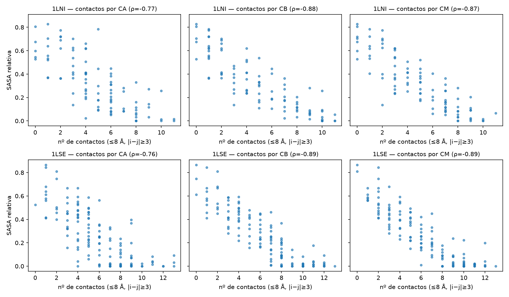

Cómo leer el gráfico: cada punto es un aminoácido (96 por panel en 1LNI y 129 en 1LSE, glicinas incluidas). Los tres paneles de cada fila muestran los mismos aminoácidos. La altura de cada punto es la SASA relativa, que se calcula con todos los átomos del aminoácido y es una sola, así que cada aminoácido está a la misma altura en los tres paneles. Lo que cambia es su posición horizontal, porque el número de contactos depende de desde qué punto se cuenten (de CA a CA, de CB a CB o de CM a CM). Por ejemplo, el Asp79 de 1LNI está a altura 0,08 en los tres paneles, pero tiene 6 contactos contados desde el CA, 9 desde el CB y 7 desde el CM. Algunos aminoácidos caen exactamente en el mismo lugar y se ven como un solo punto (más oscuro, por la transparencia): en 1LNI quedan 93 o 94 posiciones distintas de 96 según el panel, y las coincidencias son casi todas aminoácidos completamente enterrados (SASA relativa 0) con la misma cantidad de contactos.

La correlación es fuertemente negativa en todos los casos: cuantos más contactos tiene un residuo, más enterrado está, que es lo esperable. Todas son estadísticamente significativas con holgura (p < 10⁻¹⁹ en todos los casos). Dos cosas se repiten en las dos proteínas:

- la correlación es mejor con la SASA relativa que con la absoluta, porque la absoluta mezcla el grado de exposición con el tamaño del aminoácido;
- contar contactos por CB o por centro de masa funciona mejor que por CA. El CA está en el esqueleto, mientras que la SASA depende sobre todo de la cadena lateral, que es lo que sobresale hacia afuera o hacia adentro de la proteína. La mejora (de ρ ≈ −0,77 a ρ ≈ −0,88) se repite en las dos proteínas; entre CB y centro de masa, en cambio, no hay diferencia apreciable.

**¿Depende de la separación mínima?** Para contar los contactos en 6ii excluimos a los residuos separados por menos de 3 posiciones en la secuencia, un valor que elegimos nosotros. Para ver si la conclusión depende de esa elección, repetimos el cálculo con separación mínima 1 (solo se excluye al propio residuo) y 4. La cantidad de contactos cambia bastante (en 1LSE por CB, 10,0 contactos promedio con separación 1, 6,3 con 3 y 5,2 con 4), pero la correlación entre cuántos contactos tiene y qué tan expuesto está al agua casi no se mueve (−0,89, −0,89 y −0,85), y lo mismo ocurre con CA y CM y en 1LNI: en ningún caso la diferencia supera 0,06. Aunque cambie la cantidad de contactos, el orden de los residuos se mantiene: los que tienen más contactos siguen siendo los más enterrados, así que la conclusión no depende de esta elección.

## 6iv

> **6iv)** Parado en el CB de las cadenas laterales, defina el radio de una esfera, y mida el número de vecinos polares (S,T,K,R,D,E,Q,N) y no polares (I,L,V,W,Y,F,M) midiendo distancias entre CA, entre CB, y desde el centro de masa de la cadena lateral. Definir al menos 3 radios de esfera.

Usamos cuatro radios: 6, 8, 10 y 12 Å. Para cada residuo contamos cuántos *otros* residuos polares y no polares tienen su punto representativo dentro de la esfera, con el mismo tipo de punto en el centro y en los vecinos (CA con CA, CB con CB, CM con CM). Los aminoácidos que no están en ninguna de las dos listas de la consigna (G, A, C, P, H) no se cuentan en ninguna clase.

Promedio de vecinos por residuo:

| | radio | 1LNI no polares | 1LNI polares | 1LSE no polares | 1LSE polares |
|---|---|---|---|---|---|
| CA | 6 Å | 1,6 | 2,1 | 1,6 | 2,5 |
| | 8 Å | 3,1 | 3,8 | 2,9 | 4,3 |
| | 10 Å | 5,5 | 6,6 | 5,4 | 7,5 |
| | 12 Å | 8,6 | 10,3 | 8,6 | 11,7 |
| CB | 6 Å | 1,4 | 1,7 | 1,5 | 2,0 |
| | 8 Å | 3,2 | 3,6 | 3,1 | 4,2 |
| | 10 Å | 5,4 | 6,2 | 5,7 | 7,1 |
| | 12 Å | 8,6 | 9,9 | 8,9 | 11,3 |
| CM | 6 Å | 1,2 | 1,2 | 1,3 | 1,5 |
| | 8 Å | 2,7 | 3,0 | 2,8 | 3,3 |
| | 10 Å | 5,2 | 5,8 | 5,3 | 6,3 |
| | 12 Å | 8,3 | 9,1 | 8,6 | 10,3 |

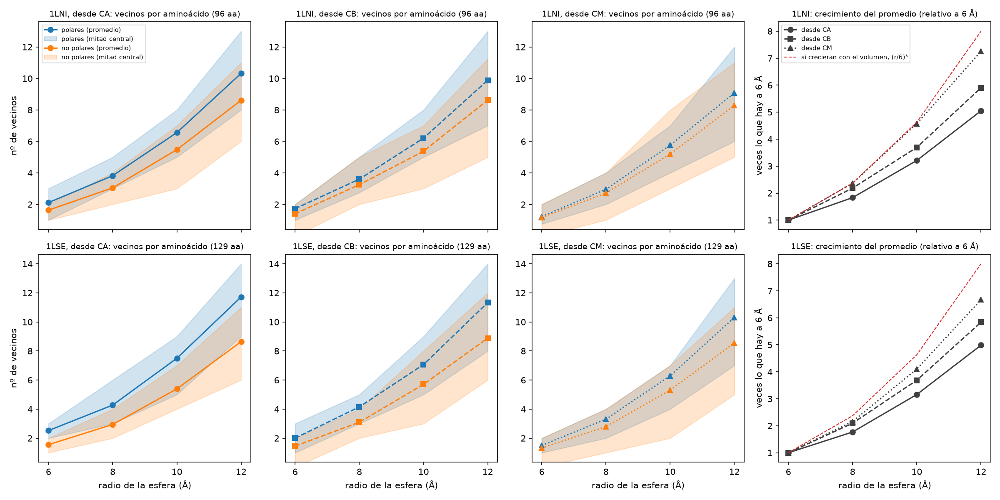

**Cómo leer el gráfico.** Cada punto no es un aminoácido sino un promedio. El conteo se hace para cada aminoácido por separado, con su propia esfera, y el gráfico muestra el promedio sobre los 96 aminoácidos de 1LNI o los 129 de 1LSE. Por ejemplo, en 1LNI, contando vecinos polares desde el CB con radio 8 Å, cada aminoácido tiene entre 0 y 7, y el promedio es 3,60 (346 / 96); los conteos de cada aminoácido están en `data/out/ex6_residuos.csv`. Cada fila corresponde a una proteína. Los tres primeros paneles son uno por punto de medición (CA, CB y CM): la línea es el número promedio de vecinos según el radio (azul polares, naranja no polares) y la banda sombreada es la mitad central de los aminoácidos (entre el percentil 25 y el 75, es decir, sin el cuarto con menos vecinos ni el cuarto con más). El último panel muestra cuánto crece el total de vecinos respecto de 6 Å, comparado con lo que crecería el volumen de la esfera, (r/6)³, en rojo punteado.

**Qué muestra.**

1. **En promedio hay más vecinos polares que no polares**, en todas las combinaciones salvo una: 1LNI medido desde el centro de masa con radio 6 Å, donde empatan (1,2 y 1,2).
2. **Pero los aminoácidos varían mucho entre sí.** Medido desde el CB con radio 12 Å, los aminoácidos de 1LNI tienen en promedio 9,9 vecinos polares, pero la mitad central va de 7 a 13 y el rango completo de 3 a 18; para los no polares, el promedio es 8,6, la mitad central va de 5 a 11 y el rango de 0 a 19. La diferencia entre los promedios de los dos grupos (1 a 2 vecinos) es chica comparada con esa variación, y por eso las bandas se superponen casi por completo: que haya más vecinos polares es cierto en promedio, pero para un aminoácido en particular dice poco. Las bandas además se ensanchan con el radio (desde el CB, la mitad central mide 1 o 2 vecinos de ancho con 6 Å y unos 6 con 12 Å), porque con esferas grandes se acentúa la diferencia entre los aminoácidos de la superficie, con media esfera en el agua, y los del interior.
3. **Los vecinos crecen más lento que el volumen de la esfera.** Al pasar de 6 a 12 Å el volumen se multiplica por 8, pero los vecinos solo por ~5 medidos desde el CA, ~6 desde el CB y ~7 desde el centro de masa (ajustando una potencia, el exponente da entre 2,3 y 2,9, en lugar de 3).

**Por qué los vecinos crecen más lento que el volumen.** En esta parte, a diferencia de 6ii, no excluimos a los vecinos de secuencia de los conteos, porque la consigna no lo pide. Para entender el crecimiento separamos los vecinos en dos tipos, los de cadena (a una o dos posiciones en la secuencia) y el resto, y encontramos tres efectos:

1. **Los vecinos de cadena inflan el punto de partida.** Los CA de aminoácidos consecutivos están siempre a ~3,8 Å, así que siempre caen dentro de la esfera de 6 Å. A 6 Å son vecinos de cadena el 58% de los vecinos medidos desde el CA, entre el 47% y el 53% desde el CB y solo el 22–23% desde el centro de masa, porque las cadenas laterales de aminoácidos consecutivos apuntan en direcciones distintas. Como el crecimiento se mide respecto de 6 Å, esos vecinos fijos hacen que parezca más lento, sobre todo desde el CA.
2. **Sin los vecinos de cadena, los conteos crecen más rápido que el volumen**: de 6 a 12 Å, ×10,1 desde el CA y ×10,6 desde el CB en 1LNI (×10,3 y ×9,4 en 1LSE), contra el ×8 del volumen; desde el centro de masa, ×7,8 y ×7,2. Es decir que a 6 Å hay menos vecinos (fuera de los de cadena) que con un reparto uniforme. La explicación probable es que los átomos ocupan espacio: dos aminoácidos no pueden acercarse más que cierta distancia sin chocar, así que una esfera chica deja poco lugar para otros aminoácidos además de los de la cadena.
3. **El borde de la proteína frena el crecimiento con radios grandes.** Con esferas grandes, la de un aminoácido de la superficie queda en parte en el agua, donde no hay vecinos. Es coherente con que en 1LNI, la más chica de las dos proteínas, medida desde el centro de masa, el crecimiento siga a la curva del volumen hasta 10 Å y recién se aparte a 12 Å.

Que la línea del centro de masa quede más cerca de la del volumen no la hace "más correcta": puede deberse en parte a que en ella los efectos se compensan, porque el primero es más débil y el segundo y el tercero empujan en sentidos opuestos.

**Qué radio conviene.** Con 6 Å hay en promedio uno o dos vecinos de cada clase, así que el conteo es muy ruidoso; con 12 Å la esfera abarca una fracción grande de proteínas de este tamaño y deja de describir el entorno inmediato del aminoácido. Los radios intermedios, 8 y 10 Å, son los más razonables.

## 6v

> **6v)** Evalúe la correlación entre el número de vecinos polares y no polares, y el pKa de los residuos de los PDB de la siguiente tabla.

Los trece residuos de la tabla son aspárticos (lo verificamos en el código). Contando todos los aspárticos de cada proteína encontramos además que la tabla los cubre casi por completo: la lisozima (1LSE) tiene exactamente 7 aspárticos, que son los 7 de la tabla, y la ribonucleasa Sa (1LNI, cadena A) tiene 7, de los cuales la tabla incluye 6; falta el Asp1, el primer aminoácido de la cadena. Lo notamos al armar una visualización del ejercicio 3 que pintaba todos los aspárticos de la lisozima de un color y los de la tabla de otro: el segundo color tapaba por completo al primero, porque los dos conjuntos eran el mismo. El pKa de un ácido aspártico aislado en agua es ~4; en una proteína se corre según su entorno. Para cada uno calculamos el corrimiento ΔpKa = pKa experimental − 4 y lo correlacionamos (Spearman) con el número de vecinos de cada clase, para los tres tipos de punto y los cuatro radios.

| PDB | Asp | pKa exp. | ΔpKa | RSA | polares (CB, 8 Å) | no polares (CB, 8 Å) |
|---|---|---|---|---|---|---|
| 1LNI | 17 | 3,72 | −0,28 | 0,45 | 4 | 4 |
| 1LNI | 25 | 4,87 | +0,87 | 0,62 | 1 | 1 |
| 1LNI | 33 | 2,39 | −1,61 | 0,08 | 4 | 5 |
| 1LNI | 79 | 7,37 | +3,37 | 0,08 | 4 | 8 |
| 1LNI | 84 | 3,01 | −0,99 | 0,33 | 3 | 1 |
| 1LNI | 93 | 3,09 | −0,91 | 0,30 | 3 | 4 |
| 1LSE | 18 | 2,66 | −1,34 | 0,35 | 3 | 5 |
| 1LSE | 48 | 1,60 | −2,40 | 0,53 | 4 | 0 |
| 1LSE | 52 | 3,68 | −0,32 | 0,14 | 10 | 2 |
| 1LSE | 66 | 0,90 | −3,10 | 0,20 | 7 | 1 |
| 1LSE | 87 | 2,07 | −1,93 | 0,41 | 3 | 1 |
| 1LSE | 101 | 4,09 | +0,09 | 0,54 | 3 | 2 |
| 1LSE | 119 | 3,20 | −0,80 | 0,46 | 2 | 1 |

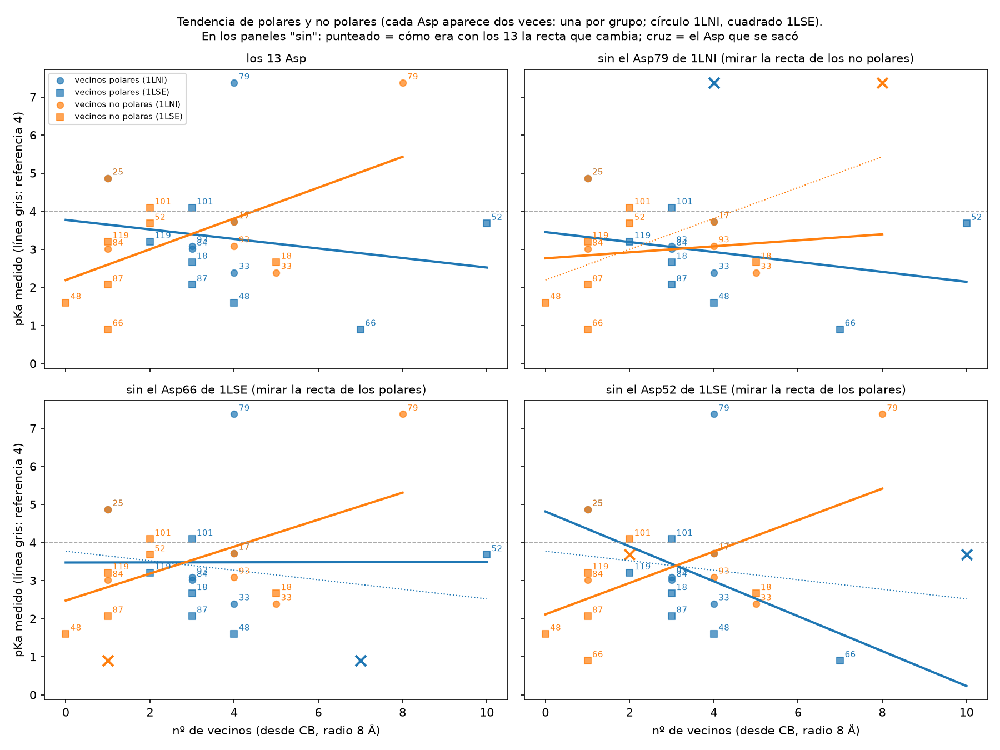

**Una primera mirada: las rectas de tendencia.** El primer panel de este gráfico pone los dos grupos de vecinos en los mismos ejes (medidos desde el CB, con radio 8 Å): el número de vecinos polares de cada aspártico en azul y el de no polares en naranja, contra su pKa medido, con el número de cada aspártico al lado (círculos para 1LNI, cuadrados para 1LSE). Cada aspártico aparece dos veces, una por grupo; el Asp17 y el Asp25 tienen la misma cantidad de vecinos de los dos grupos, así que sus dos puntos caen en el mismo lugar. A cada grupo le ajustamos una recta por mínimos cuadrados (con `np.polyfit`): de todas las rectas posibles, la que minimiza la suma de los cuadrados de las distancias verticales entre cada punto y la recta. No es una línea que une los puntos sino la que pasa "por el medio" de la nube, y no tiene por qué pasar por ninguno; su pendiente indica cuánto cambia el pKa, en promedio, por cada vecino más. Con los 13 aspárticos (panel de arriba a la izquierda) las rectas van en sentidos opuestos, la de los no polares sube (+0,40 por vecino) y la de los polares baja (−0,13), y se cruzan formando una X, que es la forma visual de la hipótesis: los vecinos no polares suben el pKa y los polares lo bajan. Con los otros dos puntos de referencia el patrón es el mismo (pendientes de −0,14 y +0,56 desde el CA, y de −0,28 y +0,61 desde el centro de masa).

**Por qué esa X es menos concluyente de lo que parece.** Una recta resume una nube de puntos en una tendencia limpia, y da una sensación de certeza que estos datos no tienen. Los otros tres paneles del gráfico lo muestran: en cada uno se repite el ajuste sacando un solo aspártico (marcado con una cruz), y la recta que cambia aparece además punteada tal como era con los 13, para comparar.

- **La recta de los no polares la sostiene un solo aspártico.** El Asp79 de 1LNI está aislado arriba a la derecha (8 vecinos no polares, pKa 7,37). Sin él (panel de arriba a la derecha), la pendiente de los no polares baja de +0,40 a +0,08: la recta queda casi horizontal. Lo mismo ocurre desde el CA (de +0,56 a +0,28) y desde el centro de masa (de +0,61 a +0,17).
- **La recta de los polares también depende de pocos puntos** (paneles de abajo). Sin el Asp66 de 1LSE (7 vecinos polares, pKa 0,90) su pendiente pasa de −0,13 a 0,00, es decir, queda plana; sin el Asp52 de 1LSE (10 vecinos polares, pKa 3,68) pasa a −0,46, mucho más empinada. Un solo residuo cambia la tendencia en un sentido o en el otro.
- **El punto donde se cruzan las rectas no tiene significado.** Que se crucen es una consecuencia geométrica de que tengan pendientes de signo opuesto, no una propiedad de los aspárticos.
- **Los puntos quedan lejos de las rectas.** El R², la fracción de la variación del pKa entre aspárticos que explica cada recta, es 0,34 para los no polares y 0,03 para los polares: la recta de los polares tiene pendiente negativa pero prácticamente no explica nada, y sin ella no se vería ninguna tendencia en los puntos azules. En promedio, cada aspártico queda a 1,3–1,5 unidades de pKa de su recta, mucho si se tiene en cuenta que los pKa de la tabla van de 0,9 a 7,4. Como comparación, la relación entre contactos y SASA relativa del ejercicio 6iii tiene un R² de 0,74–0,77. Una recta de mínimos cuadrados siempre se puede calcular, haya o no relación; lo que indica si la tendencia es real es qué tan cerca de ella quedan los puntos.
- **Las rectas no tienen asociada ninguna medida de incerteza.** Con 13 puntos y correlaciones no significativas (ver abajo), otra muestra de 13 aspárticos podría dar rectas bastante distintas.

Por eso, además de las rectas, conviene mirar los puntos uno por uno, que es lo que muestra el gráfico siguiente.


El gráfico muestra los datos de la tabla anterior: cada punto es uno de los 13 aspárticos, con su número al lado (círculos para 1LNI, cuadrados para 1LSE; azul para vecinos polares y naranja para no polares, la misma convención que en el gráfico anterior y en los notebooks), con su número de vecinos polares (arriba) o no polares (abajo) en el eje horizontal y su pKa medido en el vertical; la línea punteada es el pKa de referencia, 4. Usamos un solo radio, 8 Å, el mismo de 6ii y de las visualizaciones del notebook, fijado de antemano para no elegir el radio que mejor correlaciona. Las correlaciones de las 24 combinaciones (3 puntos × 4 radios × 2 grupos) se imprimen al correr el ejercicio y se comentan más abajo.

Este gráfico deja ver dos cosas que los coeficientes de correlación esconden. La primera es que el Asp79 de 1LNI queda aislado, arriba a la derecha, en los tres paneles de vecinos no polares, y sostiene buena parte de esa relación: sacándolo, la correlación con los vecinos no polares a 8 Å baja de 0,54 a 0,41 desde el CA, de 0,39 a 0,22 desde el CB y de 0,41 a 0,25 desde el centro de masa. Con los vecinos polares ocurre lo contrario: sin el Asp79 la correlación negativa se mantiene o se refuerza (desde el centro de masa pasa de −0,36 a −0,51). Ninguna de estas correlaciones es significativa, con o sin el Asp79. La segunda es que los aspárticos de la lisozima (cuadrados) tienen todos pKa iguales o menores que el de referencia, mientras que los de la ribonucleasa están más repartidos. Las dos observaciones muestran lo mismo: con tan pocos residuos, un solo aspártico puede mover mucho el resultado.

El signo de la correlación es consistente en casi todas las combinaciones: **más vecinos no polares se asocian con un pKa más alto, y más vecinos polares con un pKa más bajo**, que es lo esperable. Las correlaciones más fuertes son con centro de masa y radio de 10 Å (ρ = 0,55 para no polares, −0,53 para polares) y con CA a 8 Å (ρ = 0,54 para no polares).

Sin embargo, **ninguna de estas correlaciones es estadísticamente significativa**: el menor p-valor es 0,05, y lo obtuvimos probando 24 combinaciones (3 tipos de punto × 4 radios × 2 clases) sobre solo 13 residuos. Con tantas combinaciones, encontrar alguna con p ≈ 0,05 es esperable aunque no haya ningún efecto real. El signo de la correlación sí es el esperado en 23 de las 24 combinaciones (positivo para los vecinos no polares en 11 de 12, negativo para los polares en las 12), pero eso no agrega mucha evidencia: las 24 combinaciones no son independientes, porque son los mismos 13 aspárticos contados con esferas que se superponen (un aspártico con muchos vecinos a 8 Å los tiene también a 10 Å). Lo que podemos sostener es que los datos son compatibles con la explicación química, pero no alcanzan para demostrarla. Es probable además que el número de vecinos sea una medida demasiado gruesa del entorno: no distingue a qué distancia está cada vecino ni si tiene carga.

**Cuántos aspárticos harían falta.** La limitación principal es el tamaño de la muestra. Con 13 residuos, solo se puede detectar con confianza una relación muy fuerte: usando la aproximación habitual para correlaciones (transformación de Fisher, nivel de significación 0,05), la probabilidad de detectar la relación si existe sería del 50% si fuera tan fuerte como nuestra mejor correlación (ρ = 0,55), del 27% si fuera moderada (ρ = 0,4) y del 16% si fuera débil (ρ = 0,3). Para tener un 80% de probabilidad de detectarla harían falta unos 24, 47 y 85 aspárticos respectivamente, y más todavía si se prueban varias combinaciones de punto y radio, como aquí. Ampliar la muestra no es posible con lo que tenemos: hace falta el pKa medido experimentalmente de cada residuo, que no surge de la estructura, y la tabla de la consigna ya incluye todos los aspárticos de la lisozima y todos los de la ribonucleasa salvo el Asp1. Un análisis concluyente requeriría pKa medidos de muchas más proteínas. Como referencia, la SASA relativa sola no correlaciona con el ΔpKa (ρ = 0,14, p = 0,65): no alcanza con saber si el residuo está enterrado, importa con qué está rodeado.

**Visualización.** El notebook `ex6_vecinos.ipynb` tiene dos partes de apoyo visual antes de la comparación de los dos aspárticos. La primera ubica los niveles que usa el ejercicio, de lo grande a lo chico, sobre la ribonucleasa: el archivo con sus dos copias de la proteína (cadenas A y B); la cadena A como una cinta de 96 aminoácidos con uno solo resaltado (el Asp79); ese aminoácido de cerca, con el nombre de cada átomo, el eslabón en un color, la cadena lateral en otro y el CM dibujado como un punto aparte (porque no es un átomo sino un punto calculado); y la cadena reducida a un punto por aminoácido (su CB), coloreado según el grupo de la consigna (44 polares, 28 no polares y 24 de ningún grupo). La segunda parte dibuja el conteo de 6iv: una esfera transparente centrada en el CB del Asp79, con los aminoácidos que caen adentro como bolas grandes del color de su grupo y los que quedan afuera como puntos chicos, para los cuatro radios (6, 8, 10 y 12 Å), y la misma esfera de 8 Å para el Asp25. Cada dibujo imprime el conteo, y el notebook verifica que coincida con la tabla del ejercicio.

Después, Para dos aspárticos de la ribonucleasa (1LNI) con comportamientos opuestos dibujamos sus vecinos dentro de 8 Å, medidos entre CB: el aspártico en verde, los vecinos polares en azul y los no polares en naranja, dentro de una esfera transparente de 8 Å centrada en el CB del aspártico. El cálculo usa las mismas funciones del ejercicio 6, de modo que los números coinciden con su tabla, y el notebook imprime la lista de vecinos con sus distancias:
- **Asp79** (pKa 7,37, el más alejado del valor de referencia de toda la tabla): 4 vecinos polares (Thr72, Glu78, Gln77, Gln94) y 8 no polares (Ile92, Ile70, Tyr80, Leu19, Ile71, Leu91, Tyr81, Ile22). Doce vecinos dentro de 8 Å.
- **Asp25** (pKa 4,87, cercano al de referencia): 1 vecino polar (Ser24) y 1 no polar (Ile22). Solo dos vecinos dentro de 8 Å, y además está expuesto al agua (SASA relativa 0,62, ejercicio 6).

El contraste ilustra la interpretación del ejercicio 6: un aspártico rodeado de residuos no polares tiene su pKa muy corrido hacia arriba, y uno sin entorno se comporta como en agua. Son dos casos elegidos por ser extremos, así que ilustran la idea pero no la prueban; la evaluación sobre los trece residuos está en el ejercicio 6. Un detalle de los números: Ile22 está exactamente a 8,0 Å del CB del Asp79, en el límite del radio, y cuenta porque el criterio es "menor o igual".

---

## 7

> **7)** Usando los módulos que armó previamente, lea el trabajo (Whitford et al. 2007) y repita el diseño experimental. A) baje las estructuras mencionadas en formato PDB. Considerando solo los carbonos alfa: B) calcule los contactos para ambas estructuras usando el método de 'cutoff'. C) calcule los contactos que están SOLAMENTE en la estructura cerrada (1AKE), usando la definición del trabajo. Calcule también los contactos exclusivos para cada estructura. Construya el mapa de contactos para cada estructura. D) mida los ángulos y los diedros considerando solamente los carbonos alfa.

**Contexto del trabajo.**

- **La proteína.** La adenilato quinasa es una enzima: una proteína que realiza una reacción química, en este caso entre dos moléculas pequeñas (ATP y AMP). Para hacerlo las sujeta cerrándose sobre ellas, como una mano: tiene un cuerpo (dominio CORE) y dos partes móviles (dominios LID y NMP) que se acercan. Existen estructuras de las dos formas: **abierta** (4AKE, sin moléculas unidas) y **cerrada** (1AKE). La cerrada se obtuvo con el inhibidor Ap5A, que según el trabajo es un análogo de las dos moléculas reales juntas: la enzima lo sujeta, se cierra y permanece cerrada.
- **La pregunta.** Las estructuras son instantáneas estáticas de cada forma, pero no muestran cómo se pasa de una a otra. El trabajo lo estudia por simulación.
- **El modelo.** Un modelo simplificado en el que cada aminoácido es una esfera ubicada en su CA (de ahí que el ejercicio use solo carbonos alfa). Esferas consecutivas están unidas por términos de enlace, ángulo y diedro, y entre esferas que en la estructura están cerca se agregan interacciones de contacto que tienden a mantener la distancia de la estructura.
- **El truco para tener dos formas.** El modelo usa los contactos de una estructura y les suma los contactos propios de la forma cerrada (*QLigand*), con una intensidad variable que representa la unión de las moléculas: con intensidad baja la proteína queda abierta y al aumentarla se cierra. Para construir ese conjunto definen los contactos propios de la forma cerrada como los únicos de la cerrada cuya distancia es más de un 50% mayor en la abierta, que es lo que calculamos en la parte C.
- **El resultado.** Durante el cierre, algunas regiones acumulan mucha tensión y se desarman parcialmente de forma transitoria ("agrietamiento"), lo que facilita el cambio. Las regiones con más tensión están cerca de los residuos 60–70 y 120–125.

**Visualización.** En el notebook `ex7_visualizacion.ipynb` están las dos formas coloreadas por dominio con los mismos colores (NMP en azul, LID en rojo, el resto en gris). En la cerrada (1AKE) el inhibidor Ap5A aparece en bastones amarillos y se ve a los dos dominios móviles cerrados sobre él. En la abierta (4AKE), que no tiene ningún ligando, el NMP y el LID quedan separados del CORE y dejan libre el hueco donde la cerrada sujeta al inhibidor.

La tercera vista superpone las dos formas. Como cada archivo tiene las coordenadas en su propio sistema de referencia (sin superponer, los CORE de las dos formas están a 79 Å de RMSD, es decir, en lugares distintos del espacio), primero movemos la abierta para que su CORE quede lo más encimado posible sobre el de la cerrada, usando solo sus carbonos alfa, así coincide y lo que queda desplazado es el movimiento de los dominios móviles. En el dibujo, el mismo tono indica el mismo dominio: oscuro para la cerrada y claro para la abierta. El RMSD de cada dominio después de esa superposición mide cuánto se mueve:

| Dominio | RMSD después de superponer por el CORE |
|---|---|
| CORE | 2,0 Å |
| NMP | 11,2 Å |
| LID | 15,6 Å |

El CORE queda encimado (2 Å; no es 0 porque el CORE también se reacomoda un poco, como muestran los contactos exclusivos dentro del CORE), mientras que el NMP y el LID se desplazan más de 10 Å, y el LID es el que más se mueve.

Los límites de los dominios (NMP 30–59, LID 122–159) no están en el archivo: los tomamos de la literatura sobre esta enzima.

**Contactos por cutoff.** Dos CA están en contacto si están a 8 Å o menos y separados por al menos 4 posiciones en la secuencia. Subimos la separación mínima respecto del ejercicio 6 porque en una hélice los CA de i e i+3 están siempre a ~5 Å, y en un modelo de solo CA ese contacto es parte de la geometría local de la hélice, no del plegamiento entre regiones. Lo verificamos con los tramos que el propio archivo declara como hélices (registros `HELIX`, 109 residuos de la cadena A de 1AKE): ahí la distancia CA(i)–CA(i+3) tiene una mediana de 5,2 Å y la CA(i)–CA(i+4), de 6,2 Å.

| | contactos |
|---|---|
| 1AKE (cerrada) | 453 |
| 4AKE (abierta) | 427 |
| compartidos | 379 |
| exclusivos de 1AKE | 74 |
| exclusivos de 4AKE | 48 |
| solo en 1AKE según el trabajo | 28 |
| solo en 4AKE según el mismo criterio | 2 |

**Cómo leer un mapa de contactos.** Es una tabla de doble entrada dibujada como imagen: fila y columna son dos aminoácidos, y la casilla está pintada si están en contacto. Es simétrico respecto de la diagonal (si el residuo 10 toca al 50, el 50 toca al 10), así que mostramos solo la mitad de abajo y cada contacto aparece una vez: en el eje horizontal, el residuo de número menor del par, y en el vertical, el de número mayor. Las estructuras locales de la proteína dejan dibujos característicos, y en la adenilato quinasa aparecen los tres (según los registros `HELIX` y `SHEET` de 1AKE):

- **Hélices**: una línea fina paralela a la diagonal y pegada a ella, porque en una hélice cada aminoácido i toca a i+4. La proteína tiene nueve, por ejemplo 12–25 y 160–188.
- **Hebras β paralelas** (dos tramos acostados uno junto al otro y recorridos en el mismo sentido): un segmento paralelo a la diagonal pero lejos de ella. El CORE tiene una lámina de cinco hebras paralelas (1–6, 27–29, 81–84, 104–110 y 192–198), que dan manchas alargadas como las de (104–110, 1–6) o (192–198, 104–110).
- **Hebras β antiparalelas** (recorridas en sentidos opuestos, como una horquilla): un segmento perpendicular a la diagonal. El LID tiene una lámina de cuatro hebras antiparalelas (122–126, 131–135, 144–146 y 151–154), que dan los cruces alrededor de 120–155.

Las manchas aisladas lejos de la diagonal son contactos entre partes de la cadena muy separadas en la secuencia que el plegamiento acerca; las que cambian entre las dos formas son las que interesan en este ejercicio.

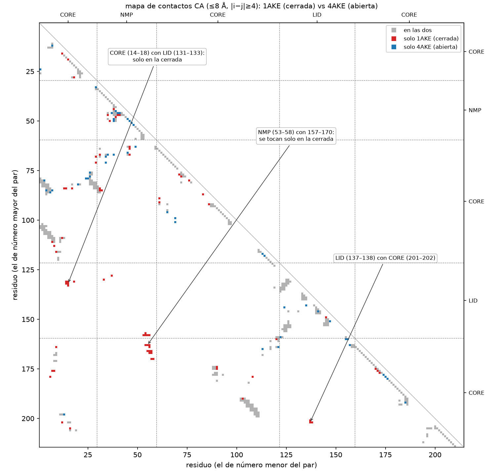

**Contactos exclusivos de cada estructura.** Son los que están en el mapa de una estructura y no en el de la otra: 74 de la cerrada y 48 de la abierta.

**Contactos solo de la forma cerrada, según la definición del trabajo.** Whitford et al. (2007) definen el conjunto de contactos que representa la unión del ligando (*QLigand*) como los contactos únicos de la forma cerrada cuya distancia CA–CA es más de un 50% mayor en la forma abierta. Es decir: exclusivo de 1AKE y con d(4AKE) > 1,5 × d(1AKE). El criterio es proporcional, no una diferencia fija en Å, y descarta los pares que solo cruzaron el umbral del cutoff sin separarse de verdad. Una diferencia con el trabajo: ellos construyen los mapas de contacto con el programa CSU, que considera todos los átomos, mientras que la consigna pide para la parte B el método de cutoff sobre los CA; aplicamos su criterio de exclusividad sobre nuestros mapas de cutoff.

El mapa combina las dos estructuras: en gris, los contactos que están en las dos; en rojo, los que solo tiene la forma cerrada (1AKE); y en azul, los que solo tiene la abierta (4AKE). Las líneas punteadas y los rótulos de los bordes marcan los dominios (CORE, NMP y LID, según la bibliografía), así que cada mancha queda ubicada en un cruce de dos dominios. Las flechas señalan los tres grupos más claros de contactos propios de la forma cerrada, que coinciden con los del criterio del trabajo: los residuos 53–58 del NMP con 157–170 (la punta del LID y el comienzo del CORE que le sigue), los residuos 14–18 del CORE con 131–133 del LID, y los residuos 137–138 del LID con 201–202 del CORE. Son contactos entre partes de la proteína alejadas en la secuencia que solo se tocan cuando la enzima se cierra. Los contactos propios de la forma abierta (azul), en cambio, están en su mayoría cerca de la diagonal o mezclados con contactos compartidos, es decir que son reacomodamientos locales.

**El cambio de cada contacto.** Para ver qué pasa con cada contacto al abrirse la enzima armamos un gráfico (`exercises/ex7/ex7_cambio_contactos.png`) con una fila por cada uno de los 74 contactos exclusivos de la forma cerrada: el punto es la distancia CA–CA en 1AKE, la punta de la flecha es la distancia en 4AKE, y el largo de la flecha es cuánto se separan los dos residuos al abrirse la enzima. Una rayita negra en cada fila marca 1,5 veces la distancia en la forma cerrada, el umbral del trabajo: el contacto lo cumple si su flecha pasa la rayita. Las filas están ordenadas de mayor a menor cambio relativo y coloreadas según los dominios del par.

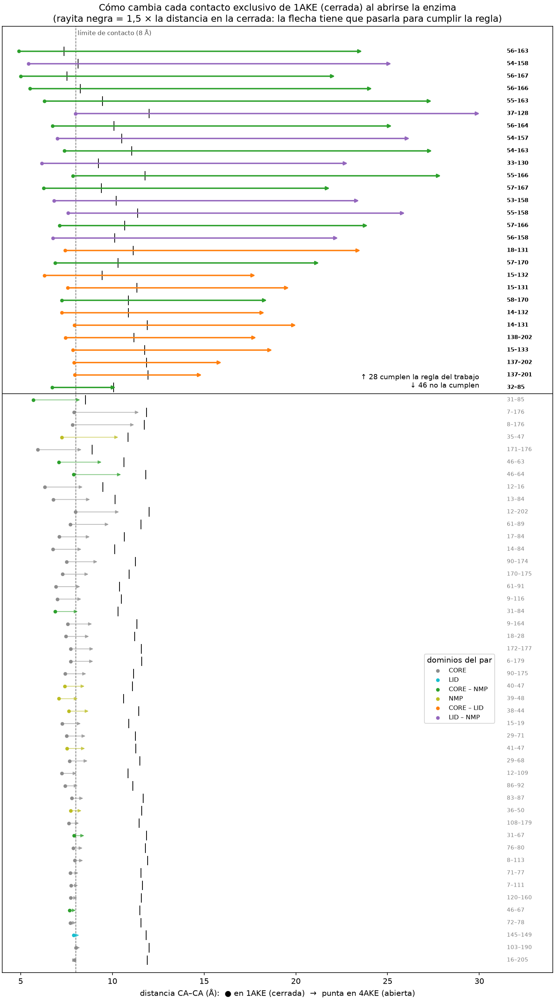

El gráfico deja ver las dos poblaciones con claridad. Arriba, los 28 contactos que cumplen la regla tienen flechas largas: residuos a 5–8 Å en la forma cerrada que en la abierta quedan a 15–30 Å; el par 55–163, por ejemplo, pasa de 6,3 a 27,4 Å, más de cuatro veces. Todos son entre dominios distintos. Abajo, los 46 restantes tienen flechas cortas que apenas cruzan la línea de 8 Å: el par 7–111, por ejemplo, pasa de 7,8 a 8,1 Å, y el 7–176, el más cercano al umbral entre los que no lo cumplen, de 7,9 a 11,4 Å (1,45 veces). El que separa los dos grupos, 32–85, pasa justo.

En términos de dominios, los 28 contactos que cumplen la regla son todos entre dominios distintos (12 CORE–NMP, 9 CORE–LID y 7 LID–NMP): son los contactos que forman el cierre de la enzima. De los 46 que no la cumplen, 40 son dentro de un mismo dominio (33 dentro del CORE): pequeños reacomodamientos internos que la definición simple de exclusividad mezcla con el cierre. Aplicando el mismo criterio en sentido inverso, la forma abierta tiene apenas 2 contactos propios (24–79 y 45–49). Los dominios (NMP 30–59, LID 122–159 y el resto como CORE) se toman de la bibliografía, porque no figuran en el archivo.

**Ángulos y diedros.** Con solo CA, cada ángulo se forma con tres CA consecutivos y cada diedro con cuatro.

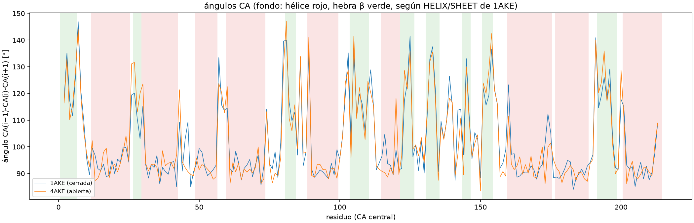

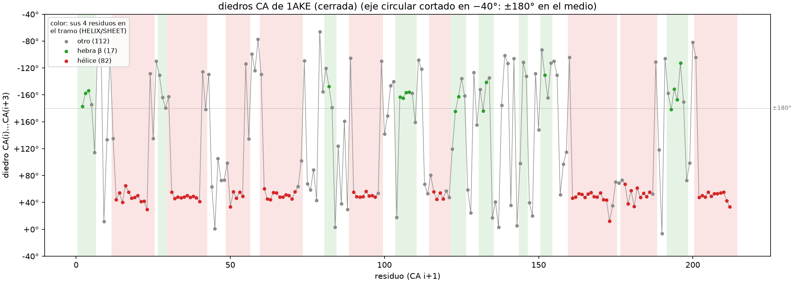

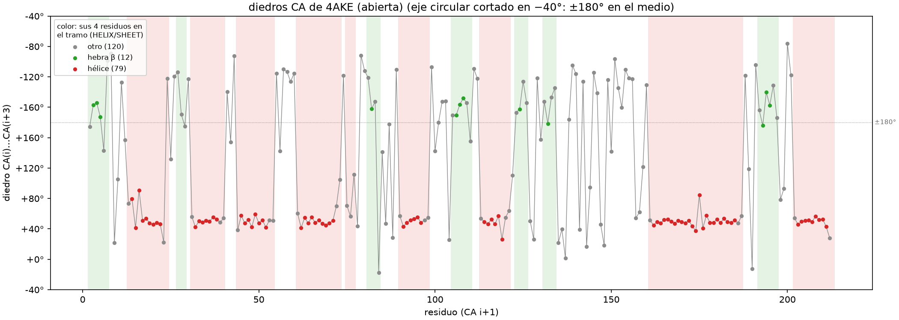

**Qué muestran.** El primer gráfico muestra los ángulos de las dos formas a lo largo de la cadena (una línea por forma), y los dos siguientes los diedros, uno por estructura: cada punto es un diedro, coloreado según si sus cuatro residuos están en un tramo que el archivo declara como hélice (rojo) o hebra β (verde), y una línea gris los une en orden. El fondo de cada panel marca esos tramos (registros `HELIX` y `SHEET`); en los ángulos se usan los de 1AKE, y en los diedros los de cada archivo. Los puntos y el fondo no coinciden del todo, y no es un error. El fondo marca aminoácidos, mientras que cada diedro se calcula con cuatro residuos consecutivos (desde uno antes hasta dos después de su posición en el eje), y lo coloreamos solo si los cuatro están en el tramo. Por eso, en cada tramo, el primer punto y los dos últimos quedan grises: su diedro incluye residuos de afuera. Las hebras de solo tres residuos (27–29 y 144–146) no tienen ningún diedro con sus cuatro residuos adentro, y quedan sin puntos verdes.

Sobre el eje de los diedros: el diedro es un ángulo de giro: −180° y +180° son la misma dirección, así que sus valores viven en un círculo. Para dibujarlos sobre un eje recto hay que "cortar" ese círculo en algún punto y estirarlo, como un collar que se corta y se extiende sobre una línea. Lo habitual es cortarlo en ±180°, pero justamente ahí están los diedros de las hebras β (cerca de ±160°), que quedarían partidos entre el borde superior y el inferior del gráfico, y la línea que une residuos consecutivos saltaría de un borde al otro. Por eso cortamos el círculo en −40°: entre −60° y −20° no cae ningún diedro de 1AKE ni de 4AKE, así que en ese punto no se parte nada. El eje va entonces de −40° (abajo) hasta +180°, que queda en el medio (línea punteada), y sigue con −160°, −120°, … hasta volver a −40° arriba. Así, las hélices son tramos planos en ~+50° y las hebras quedan enteras alrededor de ±180°, en el medio del gráfico. La figura `exercises/ex7/ex7_diedros_explicacion.png` (`main.py 7-diedros`) explica paso a paso qué es un diedro, por qué vive en un círculo y cómo queda al cortarlo en ±180° o en −40°.

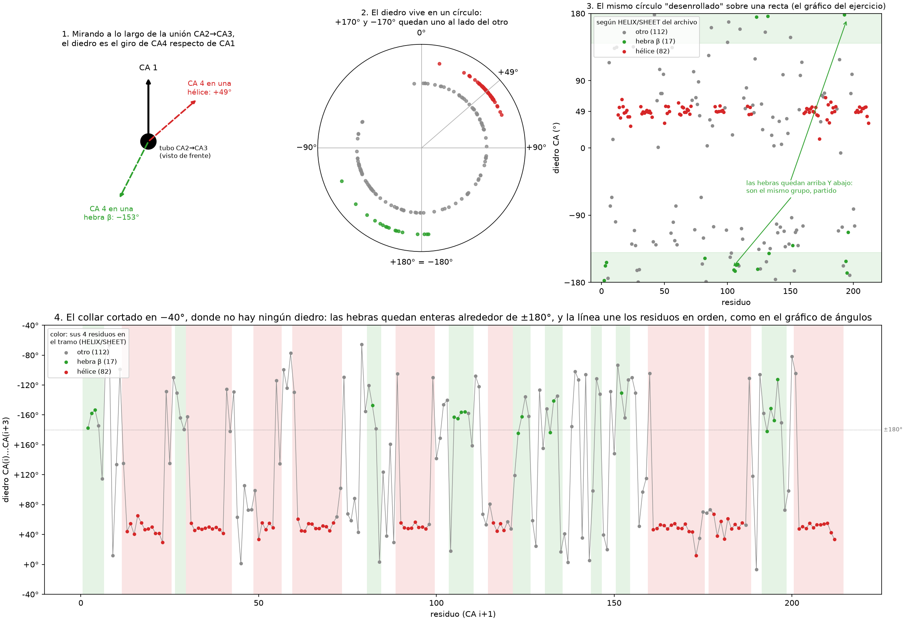

Dos cosas se destacan.

La primera es que estos valores, que son solo geometría entre puntos, alcanzan para reconocer la estructura local de cada tramo. Se ven tramos largos con ángulo ~90° y diedro ~+50°, que son las hélices α, y tramos con ángulo ~120° y diedro cercano a ±160°, que son las hebras β (tramos de cadena casi estirada). Lo verificamos con los registros `HELIX` y `SHEET` de 1AKE: dentro de las hélices (109 residuos) el ángulo tiene una mediana de 92° y el diedro de +49°; dentro de las hebras (44 residuos), 119° y −153°; y fuera de las hélices (hebras incluidas), 112° y −107°. El signo positivo del diedro en las hélices corresponde a una hélice que gira hacia la derecha, como la hélice α.

La segunda es que los ángulos y diedros son casi idénticos en las dos formas: la diferencia entre 1AKE y 4AKE tiene una mediana de 2,9° en los ángulos y de 5,0° en los diedros. A pesar del gran cambio global (RMSD de 7,1 Å, dominios que se acercan de 36 a 20 Å), la estructura local de la cadena casi no cambia: los dominios se mueven como bloques casi rígidos y el cambio se concentra en pocos lugares. Solo 11 de los 211 diedros cambian más de 30°, y 7 de ellos están en el dominio NMP (residuos 30, 43, 45, 46, 48, 49 y 59, con los cambios más grandes, de 56° y 58°, en 45 y 46); 30 y 59 son justamente los extremos del dominio, donde se une al CORE. Los otros cuatro son el 158, en el extremo del LID, y el 80, el 115 y el 173, en el CORE.

---

## 8

> **8)** Repita los cálculos para los PDB 1SU4, 4XOU y 3B9B. Haga lo mismo que en el punto 7 para cada par de estructuras.

**La proteína.** Las tres estructuras son la bomba de calcio SERCA1a, del retículo sarcoplásmico del músculo de conejo (según `TITLE` y `SOURCE` de cada archivo): una proteína de membrana que usa la energía del ATP para bombear iones calcio. Cada archivo es una instantánea de un momento distinto de su ciclo de trabajo: 1SU4 con dos iones calcio unidos; 4XOU con calcio y un análogo de ATP (AMPPCP); y 3B9B en el estado E2, sin calcio y con BeF₃⁻, un análogo del fosfato. Antes de comparar verificamos que las tres tienen la misma secuencia y la misma numeración: los 994 residuos de cada una, del 1 al 994 sin huecos, idénticos posición por posición y coincidentes con su `SEQRES`. Por eso los CA se emparejan directamente por número de residuo.

**Una analogía: el molinete.** Así como la adenilato quinasa se puede pensar como una mano que se cierra, la SERCA se puede pensar como un molinete de subte de los de ficha: una máquina metida en una pared que deja pasar a una persona de un lado al otro solo si se le da una ficha.

| molinete | bomba de calcio |
|---|---|
| la pared con el paso | la membrana |
| la puerta del paso | el dominio M (las diez hélices que cruzan la membrana) |
| la persona que quiere pasar | el ion calcio |
| la ficha | el ATP (la energía) |
| la mano que recibe la ficha | el dominio N (donde se une el ATP) |
| la ranura donde se cobra la ficha | el dominio P (donde se usa la energía) |
| el brazo que gira y mueve la puerta | el dominio A |

Las tres estructuras son tres momentos del molinete:

1. **1SU4 (con Ca): la persona entró, falta la ficha.** El calcio ya está unido en la puerta, y los dominios del lado citoplasmático están separados: la mano todavía está lejos del brazo (N a 54,4 Å de A).
2. **4XOU (Ca + ATP): se pone la ficha.** Al unirse el ATP, la mano se cierra sobre la ficha y queda pegada a la ranura y al brazo: N pasa a 31,9 Å de A y a 29,9 Å de P, y aparecen 30 contactos nuevos N–A y 18 N–P.
3. **3B9B (sin Ca): se cobró la ficha, giró el brazo y la persona salió.** La energía se usó en la ranura, donde queda un "recibo" (el BeF₃⁻, análogo del fosfato), y el brazo giró hasta apoyarse sobre la ranura: aparecen 51 contactos nuevos A–P y A queda a 30,1 Å de P, más cerca que en las otras dos estructuras. Al girar, el brazo tuerce la puerta, que se abre hacia el otro lado y deja salir al calcio; el dominio M es justamente el que más cambia por dentro (4,7–6,6 Å, contra 0,6–2,3 Å de los otros).

Después, la bomba vuelve al primer estado para el próximo ciclo. En una línea: la mano (N) agarra la ficha, el brazo (A) gira, la puerta (M) se abre del otro lado y el calcio pasa. La analogía simplifica mucho, porque el ciclo real tiene más pasos intermedios. Lo que verificamos con nuestros datos son los movimientos de los dominios —N que se acerca a A, A que se apoya sobre P, M que se reacomoda por dentro—; la función de cada movimiento (que el giro de A abre la puerta, que el calcio sale del otro lado) proviene de la bibliografía.

**Análisis.** Hicimos las tres comparaciones posibles de a dos, y cada una se analiza como el ejercicio 7: 1SU4 con 4XOU (qué cambia al unirse el ATP), 1SU4 con 3B9B (qué cambia entre tener el calcio unido y haberlo liberado) y 4XOU con 3B9B (qué cambia desde la unión del ATP hasta la liberación del calcio).

**Dominios: las piezas de la proteína.** Igual que la adenilato quinasa tenía un cuerpo (CORE) y dos partes móviles (NMP y LID), la SERCA está armada por piezas, llamadas dominios. Tiene cuatro:

- **M**, la parte que está metida dentro de la membrana (formada por diez hélices), por donde pasan los iones calcio;
- **A**, **P** y **N**, tres piezas que asoman fuera de la membrana, del lado del citoplasma. El N es donde se une el ATP, el P es donde se usa su energía y el A (*actuator*) es la pieza que transmite el movimiento hacia la membrana.

Los límites de cada dominio no figuran en el archivo: los tomamos de la bibliografía. La cadena entra y sale varias veces de algunas piezas, así que un dominio no siempre es un único tramo de residuos: A = 1–40 y 124–243, P = 330–359 y 605–737, N = 360–604, M = 41–123, 244–329 y 738–994.

**¿Las piezas cambian de forma o solo se mueven?** Para responderlo comparamos cada par de estructuras de dos maneras, con la superposición del ejercicio 5 (encimar una estructura sobre la otra y medir con el RMSD cuánto difieren los CA):

1. **La proteína entera.** Encimamos las dos estructuras completas. El RMSD da 11–13,5 Å: las estructuras son muy distintas.
2. **Cada dominio por separado.** Encimamos solo el dominio A de una estructura sobre el A de la otra, después solo el P, y así con cada uno. Ahí el RMSD es mucho más chico.

Es como comparar dos fotos de una persona, una con el brazo levantado y otra con el brazo bajo. Si encimás el cuerpo entero, no coinciden. Si encimás solo el brazo, sí, porque el brazo es el mismo y solo cambió de lugar.

| par | proteína entera | A | P | N | M |
|---|---|---|---|---|---|
| 1SU4 (con Ca) – 4XOU (Ca + ATP) | 13,5 Å | 2,3 Å | 1,6 Å | 1,4 Å | 4,9 Å |
| 1SU4 (con Ca) – 3B9B (sin Ca) | 12,1 Å | 1,5 Å | 1,7 Å | 1,3 Å | 6,6 Å |
| 4XOU (Ca + ATP) – 3B9B (sin Ca) | 11,2 Å | 2,3 Å | 0,6 Å | 1,3 Å | 4,7 Å |

(RMSD de los CA después de superponer.) Las tres piezas de afuera (A, P, N), encimadas de a una, coinciden en 0,6–2,3 Å: casi no cambian de forma. Lo que cambia entre estados es dónde está cada pieza respecto de las otras, igual que en la adenilato quinasa. La pieza de la membrana (M) sí cambia algo de forma (4,7–6,6 Å), porque sus diez hélices se reacomodan entre sí.

**¿Cómo se mueven las piezas entre sí?** Para cada dominio calculamos su centro (el promedio de las posiciones de sus CA) y medimos la distancia entre los centros de cada par de piezas de afuera. Si dos piezas se juntan, esa distancia baja:

| estructura | N–P | N–A | A–P |
|---|---|---|---|
| 1SU4 (con Ca) | 36,9 Å | 54,4 Å | 34,9 Å |
| 4XOU (Ca + ATP) | 29,9 Å | 31,9 Å | 33,9 Å |
| 3B9B (sin Ca) | 36,1 Å | 34,9 Å | 30,1 Å |

- **1SU4 (con calcio):** las tres piezas están separadas; el N y el A están lejísimos (54 Å).
- **4XOU (calcio + ATP):** al unirse el ATP, el N se acerca al P (de 37 a 30 Å) y sobre todo al A (de 54 a 32 Å). Las tres piezas quedan juntas.
- **3B9B (sin calcio):** el A queda más pegado al P que en las otras dos (30 Å).

**Contactos.** Con estas piezas en mente, comparamos los mapas de contactos como en el ejercicio 7. Cada fila de la tabla compara dos estructuras, y las columnas usan el orden en que aparecen en el nombre de la fila: "1.ª" es la de la izquierda y "2.ª" la de la derecha. Por ejemplo, en la primera fila (1SU4 – 4XOU), la 1.ª es 1SU4 y la 2.ª es 4XOU, y se lee así: 1SU4 tiene 2397 contactos y 4XOU tiene 2490; 2093 están en las dos; 304 están solo en 1SU4 y 397 solo en 4XOU. Por eso, los compartidos más los exclusivos de una estructura dan su total: 2093 + 304 = 2397 para 1SU4.

| par | contactos 1.ª | contactos 2.ª | compartidos | solo en la 1.ª | solo en la 2.ª |
|---|---|---|---|---|---|
| 1SU4 (con Ca) – 4XOU (Ca + ATP) | 2397 | 2490 | 2093 | 304 | 397 |
| 1SU4 (con Ca) – 3B9B (sin Ca) | 2397 | 2408 | 2015 | 382 | 393 |
| 4XOU (Ca + ATP) – 3B9B (sin Ca) | 2490 | 2408 | 2065 | 425 | 343 |

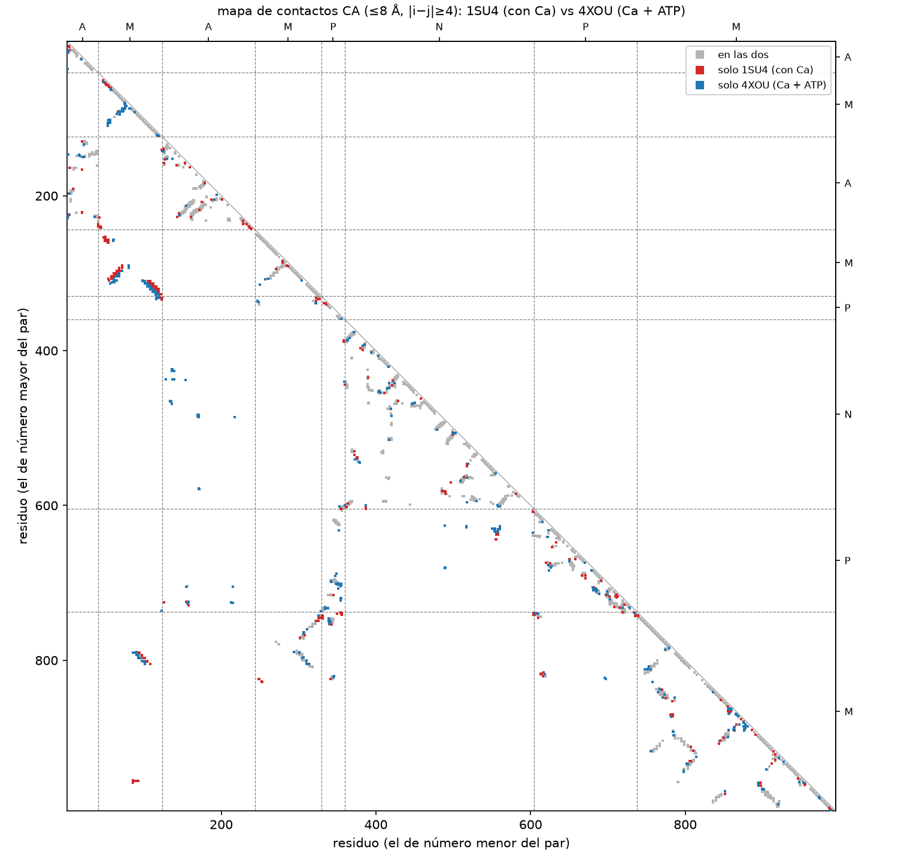
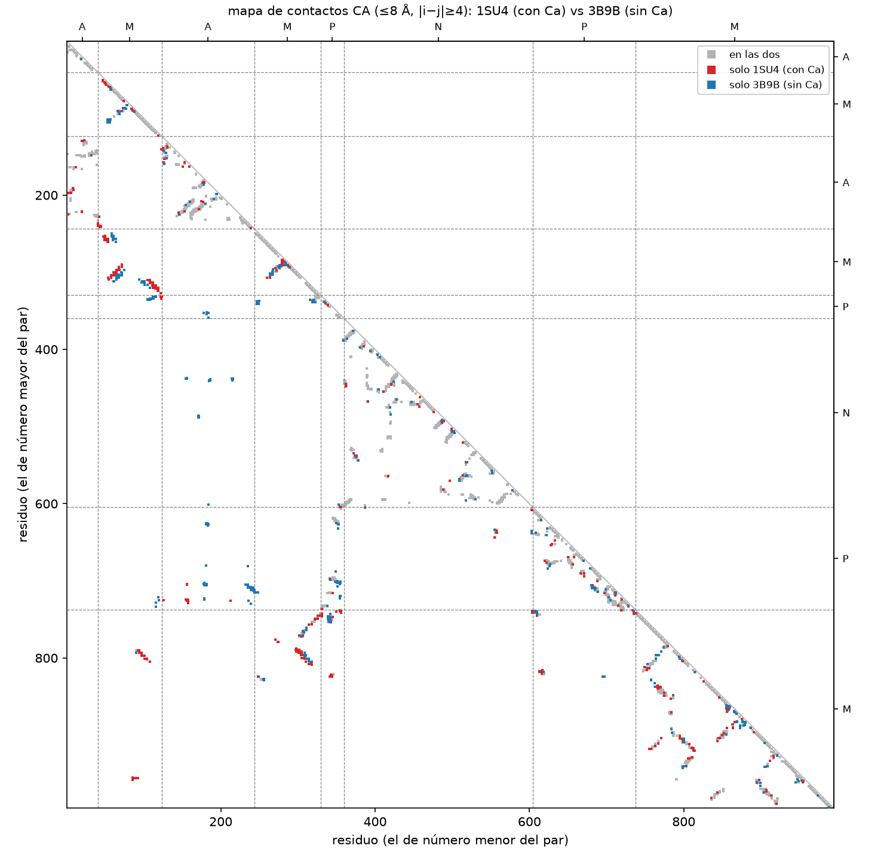
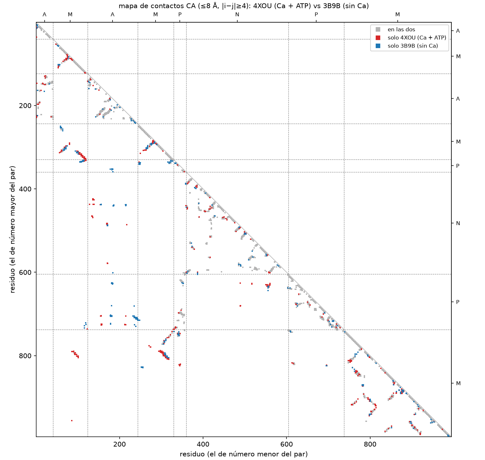

Los mapas se leen igual que el del ejercicio 7, con las líneas punteadas marcando los dominios. Con 994 residuos, cada contacto se dibuja como un punto. Para cada par se generan además los gráficos de ángulos y de diedros, igual que en el ejercicio 7 (`exercises/ex8/ex8_<A>_<B>_angulos.png` y `exercises/ex8/ex8_<A>_<B>_diedros_<estructura>.png`).

Como en el ejercicio 7, para cada par calculamos las dos cosas que pide la consigna:

1. **Los contactos exclusivos de cada estructura**: los que están en su mapa y no en el de la otra.
2. **Los contactos propios según el criterio del trabajo**: los exclusivos que, además, en la otra estructura están más de un 50% más lejos.

Las dos cuentas existen por lo que vimos en el gráfico de flechas del ejercicio 7. Un contacto exclusivo puede ser un par de residuos que se separó de verdad, o uno que solo cruzó la raya de los 8 Å (por ejemplo, de 7,9 a 8,1 Å) y casi no se movió. En la adenilato quinasa, de los 74 exclusivos de la forma cerrada solo 28 cumplían el criterio del trabajo; el resto eran movimientos chicos.

Una diferencia con el ejercicio 7: allí había una forma "cerrada" con un papel especial, y el trabajo define el criterio para ella. Acá ninguna de las tres estructuras cumple ese papel, así que aplicamos el criterio en los dos sentidos de cada par: los contactos propios de la 1.ª respecto de la 2.ª, y los de la 2.ª respecto de la 1.ª. Por eso la tabla tiene dos números por columna.

En los tres pares, entre el 13 y el 17% de los contactos de cada estructura son exclusivos, y de esos, entre un 33 y un 41% cumplen el criterio del trabajo (101 a 162 contactos según el par y la estructura). Es una proporción parecida a la de la adenilato quinasa (28 de 74, 38%):

| par | exclusivos (1.ª / 2.ª) | según el criterio del trabajo (1.ª / 2.ª) |
|---|---|---|
| 1SU4 (con Ca) – 4XOU (Ca + ATP) | 304 / 397 | 101 / 130 |
| 1SU4 (con Ca) – 3B9B (sin Ca) | 382 / 393 | 153 / 162 |
| 4XOU (Ca + ATP) – 3B9B (sin Ca) | 425 / 343 | 152 / 130 |

**El cambio de cada contacto.** Como en el ejercicio 7, para cada contacto exclusivo dibujamos una flecha: el punto es la distancia CA–CA en la estructura que tiene el contacto, la punta es la distancia en la otra, y una rayita negra marca 1,5 veces la distancia original (el umbral del trabajo). Con la SERCA hay cientos de contactos exclusivos por estructura, y un único gráfico con todos sería ilegible, así que para cada uno de los seis conjuntos (tres pares, dos sentidos) hicimos dos gráficos por separado: uno con los contactos que cumplen el criterio del trabajo (todas las flechas pasan la rayita) y otro con los exclusivos que no lo cumplen (ninguna la pasa). Son 12 gráficos. A diferencia del ejercicio 7, sacamos los números de los residuos de cada fila, porque con tantas filas no entran, y agrupamos los colores en solo dos: el par de residuos está en el mismo dominio (gris) o en dominios distintos (naranja). Con cuatro dominios habría 10 combinaciones posibles, demasiados colores para distinguir.

| par | exclusivos de… | cumplen el criterio (entre dominios distintos) | no cumplen (entre dominios distintos) |
|---|---|---|---|
| 1SU4 – 4XOU | 1SU4 (con Ca) | 101 (22%) | 203 (20%) |
| 1SU4 – 4XOU | 4XOU (Ca + ATP) | 130 (41%) | 267 (13%) |
| 1SU4 – 3B9B | 1SU4 (con Ca) | 153 (20%) | 229 (16%) |
| 1SU4 – 3B9B | 3B9B (sin Ca) | 162 (59%) | 231 (17%) |
| 4XOU – 3B9B | 4XOU (Ca + ATP) | 152 (42%) | 273 (8%) |
| 4XOU – 3B9B | 3B9B (sin Ca) | 130 (71%) | 213 (16%) |

Los gráficos muestran una división parecida a la de la adenilato quinasa. En los que no cumplen, la mitad de las flechas termina antes de 8,6 Å en la otra estructura y ninguna pasa de 11,8 Å: son contactos que apenas cruzan la línea de 8 Å. En los que cumplen, la mitad de las flechas llega más allá de 12–19 Å según el conjunto, y las más largas llegan a 29–45 Å. La separación no es tan limpia como en la adenilato quinasa: entre los que cumplen también hay flechas cortas, de residuos muy cercanos (unos 5 Å) que pasan a algo más de 8 Å, y que cumplen el criterio porque es proporcional. Pero hay una diferencia en los dominios. En la adenilato quinasa, los 28 contactos que cumplían el criterio eran todos entre dominios distintos. En la SERCA, entre los que cumplen hay más contactos entre dominios distintos que entre los que no cumplen (20–71% contra 8–20%), pero en la mayoría de los conjuntos siguen siendo minoría. Casi todos los que cumplen y son dentro de un mismo dominio están en el dominio M, el de la membrana (entre 32 y 119 por conjunto): es coherente con lo que vimos al superponer cada dominio por separado, donde el M era el único que cambiaba de forma por dentro, porque sus diez hélices se reacomodan entre sí.

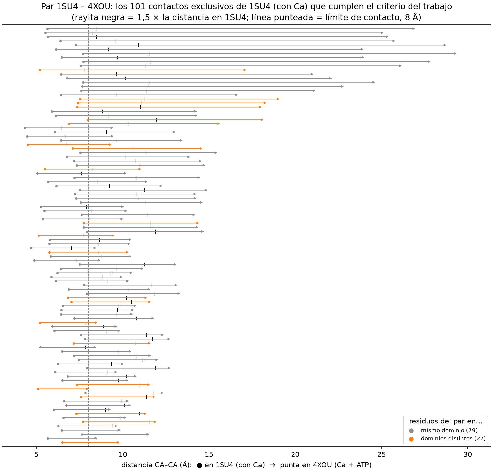
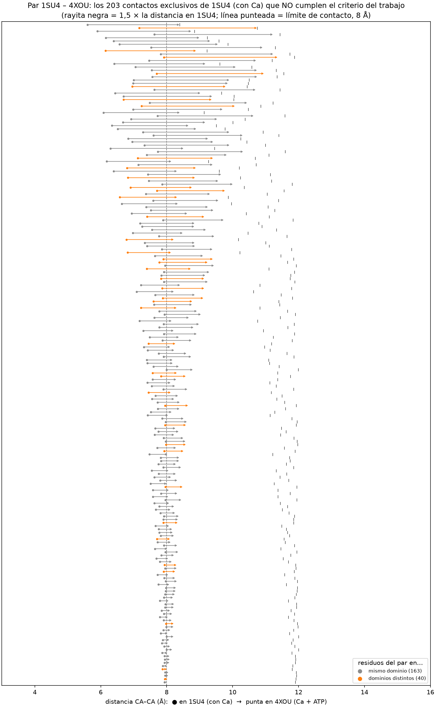
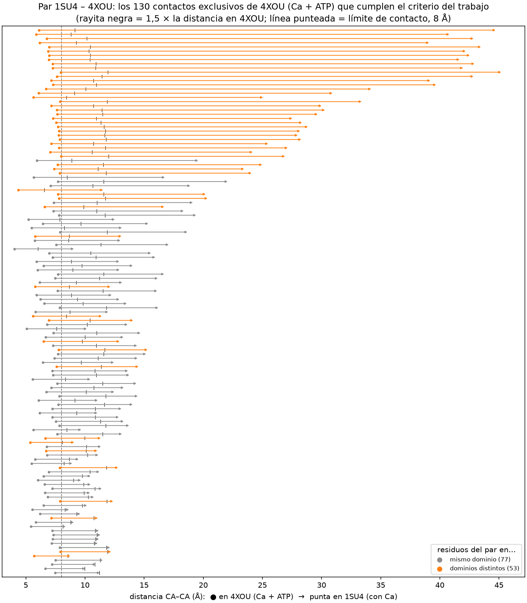
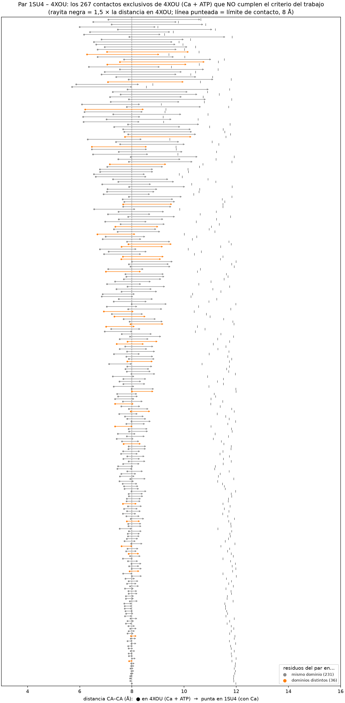
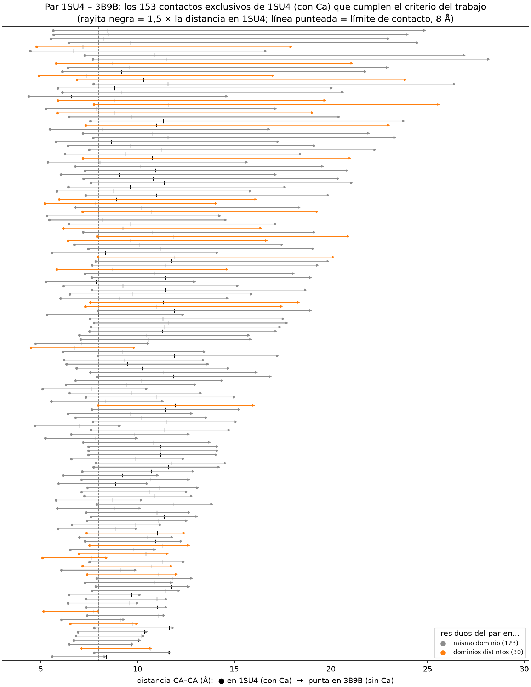
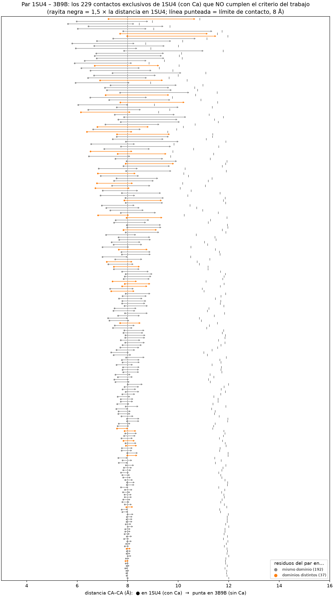
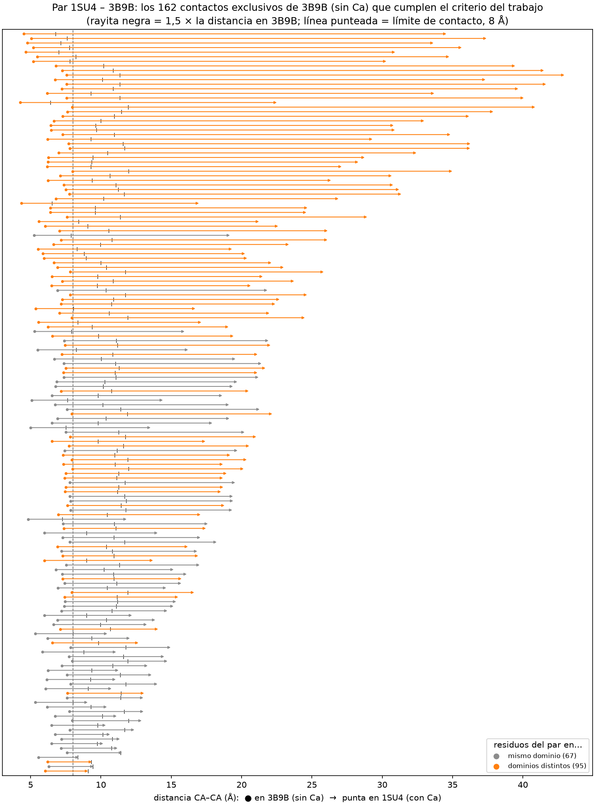
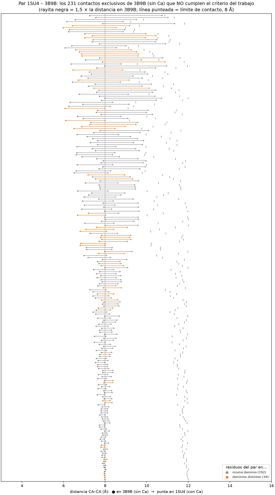
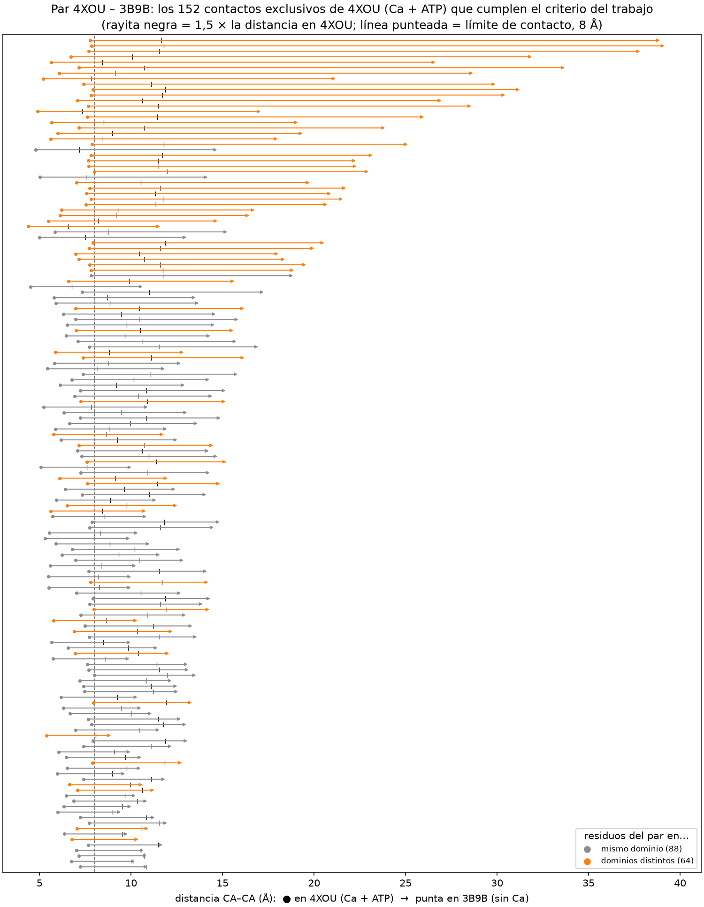
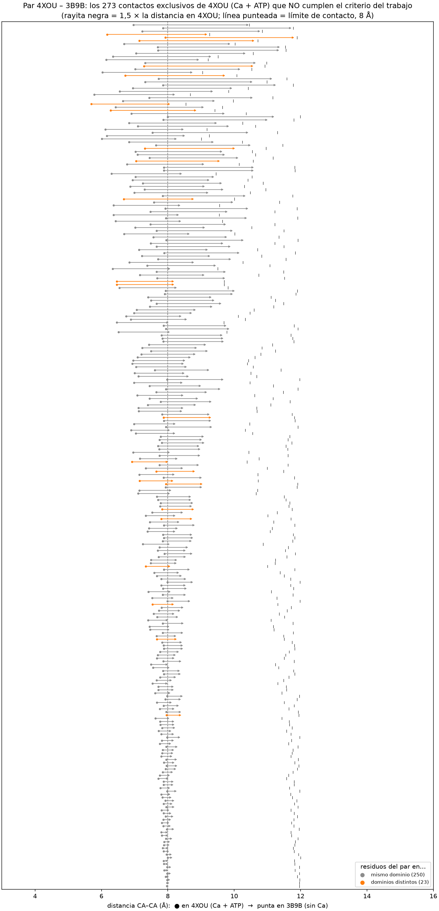
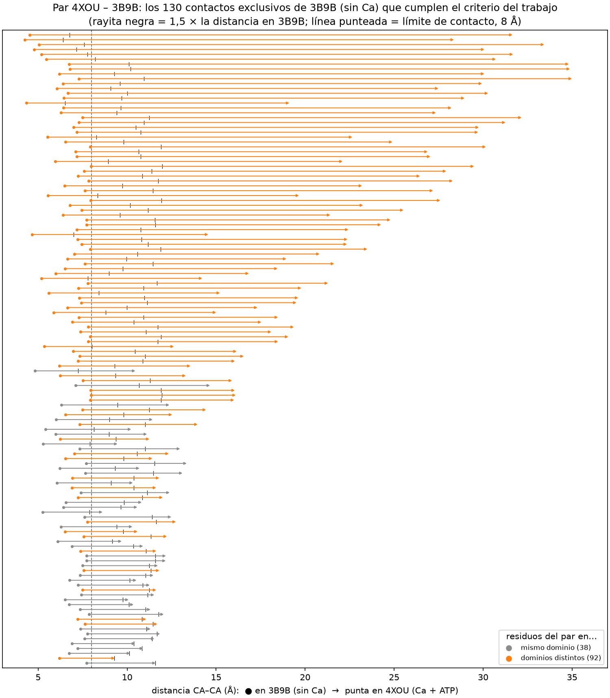
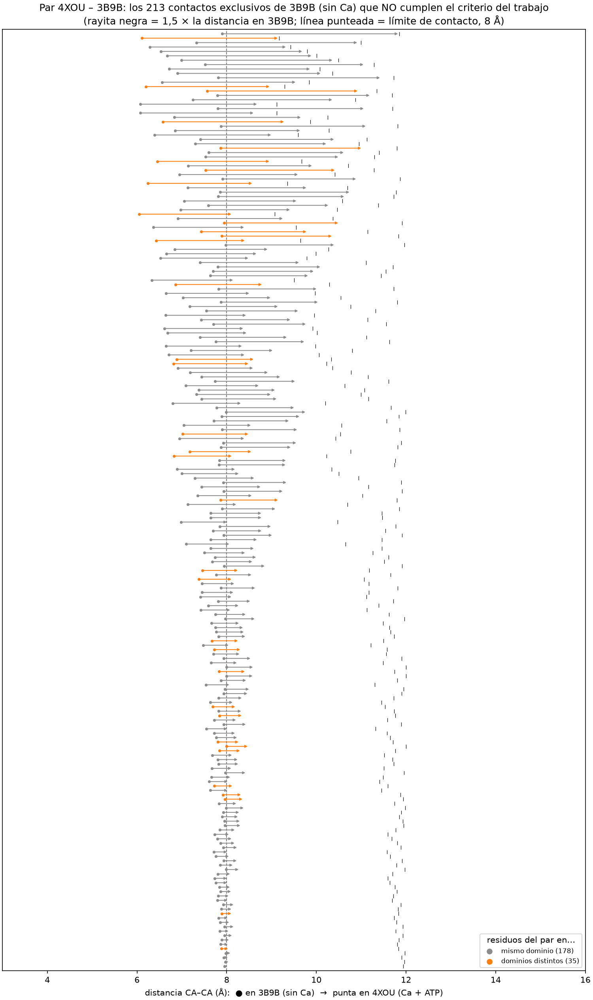

**Entre qué dominios están los contactos propios de cada estado.** Clasificando por dominio los contactos propios de cada estructura según el criterio del trabajo, y quedándonos con los que son entre dominios distintos, aparece un patrón coherente con las distancias anteriores:

| par | propios de la primera, entre dominios | propios de la segunda, entre dominios |
|---|---|---|
| 1SU4 (con Ca) → 4XOU (Ca + ATP) | 22 (N–P 8, A–M 6, M–P 6, A–P 2) | **53 (A–N 30, N–P 18, M–P 5)** |
| 1SU4 (con Ca) → 3B9B (sin Ca) | 30 (A–P 15, A–M 7, M–P 7, N–P 1) | **95 (A–P 51, M–P 25, A–N 19)** |
| 4XOU (Ca + ATP) → 3B9B (sin Ca) | 64 (A–N 25, A–P 18, N–P 16, M–P 5) | **92 (A–P 51, M–P 21, A–N 16, N–P 4)** |

Pasando de 1SU4 a 4XOU, es decir, al unirse el análogo de ATP, se forman contactos nuevos entre N y A y entre N y P: el dominio N se cierra sobre los otros dos, que es lo que muestran las distancias entre centros. Pasando a 3B9B, desde cualquiera de las otras dos, los contactos nuevos son sobre todo entre A y P (51 en los dos casos) y entre M y P: el dominio A se acomoda contra el P. En los mapas se ven, por ejemplo, los grupos azules entre los residuos 124–240 (A) y 420–490 (N) en la comparación 1SU4–4XOU. La interpretación de estos estados dentro del ciclo de bombeo de la SERCA proviene de la bibliografía; lo que verificamos con nuestros datos es la reorganización geométrica de los dominios.

Los diedros que más cambian entre pares lo hacen en ~160–180°. Los resultados de cada par quedan en `data/out/ex8_<A>_<B>.json`.

---

## 9

> **9)** Implemente el cálculo del mapa de contactos usando el algoritmo del trabajo (Noel et al. 2012). Considere solamente los carbonos alfa. Grafique el mapa de contactos para diferentes valores de S. Compare con el mapa de contactos definido por 'cutoff'.

**El trabajo.** Los autores buscan una definición de contacto para modelos como el del ejercicio 7 que resuelva un problema del corte por distancia: para incluir interacciones reales a 6 Å o más hace falta un corte generoso, pero con un corte generoso entran también pares de átomos que tienen otro átomo en medio, interacciones "a través" de un tercero que no se quieren modelar. Su solución tiene dos parámetros, la distancia de corte C y el radio de sombra S, y se describe con una metáfora: si hubiera una fuente de luz en el centro del átomo i y todos los demás átomos fueran esferas opacas de radio S, serían contactos de i todos los átomos a menos de C sobre los que no cae ninguna sombra. Con S = 0 no hay sombras y el resultado es el mapa de corte por distancia. Los valores que recomiendan, a los que llaman "el Shadow map", son C = 6 Å y S = 1 Å, pensados para mapas con todos los átomos; para los átomos unidos covalentemente usan S ≤ 0,5 Å, y en su modelo los contactos son entre residuos separados por más de tres posiciones, la misma condición que usamos (|i − j| ≥ 4).

La idea del mapa *shadow* es que dos átomos cercanos no deberían contarse en contacto si hay otro átomo justo entre ellos. Partimos de los contactos por cutoff y, para cada par i–j, buscamos si algún otro átomo k lo ocluye:

1. proyectamos k sobre la recta que une i con j: t = ((k − i) · v) / (v · v), con v = j − i;
2. si 0 < t < 1, el pie de la perpendicular p = i + t·v cae entre i y j;
3. si además la distancia |k − p| es menor que el radio de sombra S, k ocluye a i–j y ese contacto se elimina.

Esto implementa la versión de la consigna, que simplifica el método del trabajo: en Noel et al. la sombra es un cono que proyecta k visto desde i, mientras que acá es un cilindro de radio S alrededor del segmento i–j, y lo que se compara con S es la distancia |k − p|.

Consideramos como posibles oclusores a todos los átomos, no solo a los que están en contacto con i. Si k se proyecta dentro del segmento y está a menos de S de él, necesariamente está cerca de i, así que no se pierde nada, y de esta forma el resultado no depende de si se mira el par como i–j o como j–i.

Corrimos sobre los CA de 1AKE, con separación mínima de 4 en secuencia:

| cutoff | contactos (cutoff) | S = 0,5 Å | S = 1 Å | S = 2 Å | S = 3 Å |
|---|---|---|---|---|---|
| 8 Å | 453 | 453 | 453 | 448 | 321 |
| 10 Å | 1116 | 1099 | 1067 | 908 | 518 |
| 12 Å | 2283 | 2226 | 2104 | 1502 | 744 |

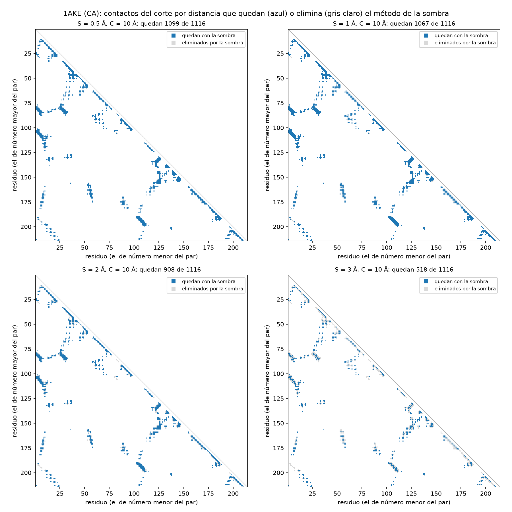

Con cutoff de 8 Å la sombra prácticamente no cambia nada hasta S = 2 Å: dos CA a menos de 8 Å casi nunca tienen un tercero en medio. El efecto aparece al agrandar el cutoff: a 12 Å, con S = 2 Å, se elimina un tercio de los contactos. Ahí está la utilidad del método: permite usar un cutoff más generoso sin contar como contacto a residuos que están "detrás" de otros. Por eso el gráfico está hecho con cutoff de 10 Å, donde la diferencia se aprecia.

En el gráfico, cada panel parte de los contactos del corte por distancia (C = 10 Å) y muestra en azul los que quedan con el método de la sombra y en gris claro los que la sombra elimina, dado que la sombra solo saca contactos. Esa propiedad la verifica el programa en cada corrida (se detiene si encuentra alguno). Los contactos eliminados aumentan con S y están repartidos por todo el mapa. A primera vista parecían concentrarse cerca de la diagonal, en las hélices, pero al medirlo no es así: con S = 1, 2 y 3 Å, solo entre el 10% y el 20% de los eliminados son pares dentro de una misma hélice, y entre el 48% y el 61% son entre residuos separados por más de diez posiciones en la secuencia. La mayoría de lo que quita la sombra son entonces pares entre partes alejadas de la cadena que están apiladas, con otra capa de la proteína en medio, que es justamente el tipo de contacto "a través de un tercero" que el método busca descartar.
